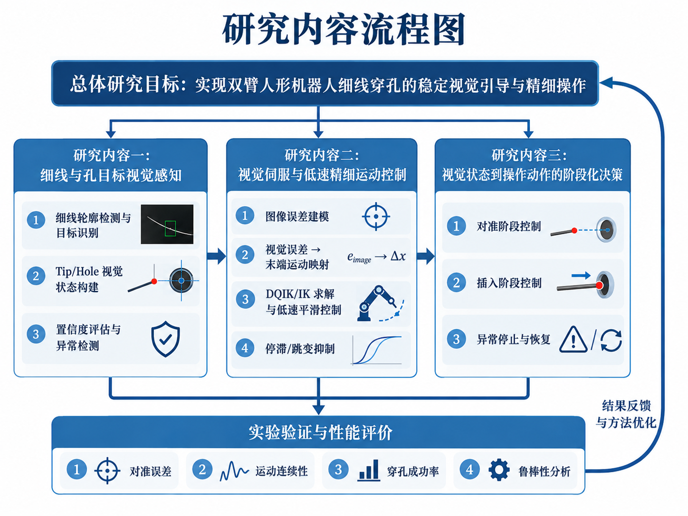
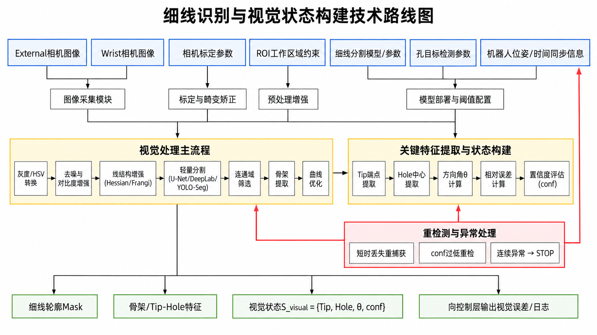
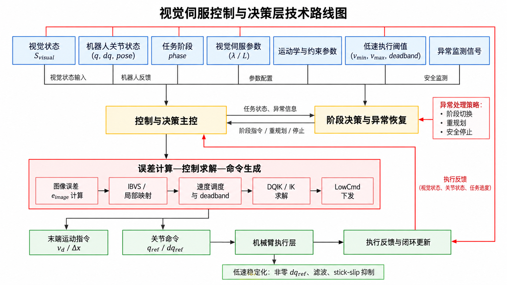

# 2026-10-26_research_plan 原始记录全文转录

来源：[原始 DOCX](../2026-10-27/机器人细线穿孔课题_全对话整理与实施说明.docx)。SHA-256：`0f8c19a18ef18d926436060eab24293d97f85614f4f08b48edae7fe6cb59e5b5`。

历史记录中的命令、建议和待办仅供追溯，不是本次操作授权。全文转录保留表格与嵌入图片；原始版式以 DOCX 为准。

课题研究资料汇编

机器人细线穿孔课题研究与实施说明

基于视觉伺服的机器人细线穿孔自适应操作方法研究

围绕可信感知、可执行微动与阶段化操作，汇总研究论证、技术选择、实验评价和后续实施安排。

开题报告与PPT梳理 · 研究现状 · 技术路线U-Net数据集与训练 · WireSegHR解读 · 指标与对照实验已有基础 · 后续计划 · 逐页汇报稿与资料索引

研究生：杜新江    专业：机械

指导教师：潘柏松    所内导师：茹浩磊

研究平台：R1-A7双臂人形机器人

整理日期：2026年10月27日

## 内容导航

按问题与实施环节组织讨论成果。章节保留当前方案、早期候选与适用边界，便于用于报告修订、实验准备和答辩。

| 章节 | 内容 | 页码 |
| --- | --- | --- |
| 01—03 | 课题定位、研究背景、场景与三个难点 | 3 |
| 04—05 | 面向难点的研究现状与文献脉络 | 6 |
| 06—09 | 总体闭环、视觉识别、运动映射与阶段决策 | 8 |
| 10 | 已有基础与当前证据状态 | 12 |
| 11—16 | U-Net任务、成像、采集、标注、训练与部署 | 13 |
| 17 | Chiu等与WireSegHR的技术解读 | 19 |
| 18—22 | 量化指标、候选目标、文献数值与实验设计 | 20 |
| 23—24 | 拟创新、风险及阶段规划 | 25 |
| 25—29 | 报告框架、PPT结构与21页演讲稿 | 27 |
| 30—31 | 待确认清单、术语与资料来源 | 32 |
| 32—34 | 核心文献及补充研究线索 | 34 |
| 图示A—C | 三张既有技术流程图档案 | 37 |

文中[S]为文件来源，[D]为对话主题，[R]为讨论中的文献线索；具体索引见第31—34节。

## 使用时保留的四类状态

已有基础：文件记载的功能、运行链路与前期测试，不自动视为完整性能验证。

拟研究与候选目标：待通过基线、独立测量和对照实验确认的方案或数值。

文献结果：保留原任务、传感器、工件、统计与人工干预条件，不直接横向排名。

图示档案：用于表达结构，不把示意曲线、候选模块或反馈箭头当作既有实验结论。

## 01 课题总览与研究定位

课题主线：可信视觉感知 → 可执行的低速精细运动 → 对准—插入阶段化决策 → 重复实验验证。

## 1.1 课题基本信息

课题名称为《基于视觉伺服的机器人细线穿孔自适应操作方法研究》。研究平台为R1-A7双臂人形机器人，采用Dex1系列夹爪及镊子等工具，以External固定相机和Wrist腕部相机提供视觉输入。学生为杜新江，指导教师为潘柏松，所内导师为茹浩磊，专业为机械。[S1；S2，第1页；S4]

核心目标不是展示一次穿孔成功，而是回答：如何在目标细小、观测退化和真实低速执行受限的条件下，持续获得可用于控制的状态，产生平稳可执行的动作，并根据任务阶段选择继续对准、受限推进、停止或恢复。[D1；S4]

## 1.2 讨论过程中的关键收敛

| 早期讨论内容 | 形成的研究定位 |
| --- | --- |
| 罗列视觉、遥操作、ACT等技术 | 围绕感知不确定、低速执行误差、插入决策三个难点组织研究。 |
| 把全部技术作为并列创新 | 模型驱动闭环为主线；遥操作是数据与实验基础；ACT是辅助对照。 |
| 直接研究尖端三维定位 | 首先研究可见线体轮廓分割，再扩展Tip/Hole状态与控制接口。 |
| 把视频输入等同于视觉跟踪 | 当前帧可以独立分割；是否利用跨帧信息另行定义。 |
| 用速度或线径描述操作精度 | 线径、孔径属于任务条件，实际对准误差需要独立测量。 |
| 先承诺性能提升 | 冻结工件、测量方式与基线，再确定目标值并进行对照。 |

## 1.3 当前研究边界

研究限定在桌面近距离、低速准静态操作；第一阶段优先研究已夹持细线后的自主穿孔。完整线轴取线、长线整理、整条线束自动化和临床医疗操作不属于现阶段必须完成的任务。双臂平台可先采用一臂操作、另一臂保持工件或固定工件，暂不把双臂同时动态调整作为必要前提。[D1；D6]

题目中的“自适应”在当前方案中主要体现为根据观测有效性、误差大小、执行异常和任务阶段调整动作。它是拟验证的机制，不等于已经建立新的自适应控制理论或完成稳定性证明。[D5；S4]

状态口径：已有基础、拟研究方案、候选目标、文献结果分别记录，不能把功能实现、论文数据或目标数值写成本系统已完成的性能。

## 02 研究背景、产业需求与具体应用场景

## 2.1 从具身智能走向机器人精细操作

背景部分形成的叙事链为：具身智能强调物理载体与环境的感知—行动反馈；机器人操作将感知和决策落实到真实任务；精细装配进一步要求局部几何识别、低速连续运动和接触阶段调整；细线穿孔提供可控、可观察、可重复的验证任务。[S2，第3—7页；D1]

汇报不宜展开大模型发展史，也不应将具身智能与人形机器人等同。视觉伺服是机器人利用环境反馈修正动作的一条技术路线，研究精细闭环操作并不要求端到端大模型作为前提。模型驱动、示教/强化学习、视觉—语言—动作模型可以作为背景分类，但不能替代针对具体难点的文献分析。[D1]

## 2.2 产业背景与任务边界

| 需求领域 | 涉及的操作 | 与本课题的联系 |
| --- | --- | --- |
| 高端制造与电子装配 | 微小元件对准、连接器插接、精密装配 | 目标识别、局部对准、受限推进。 |
| 航空航天与机电线缆装配 | 导线穿入导向孔、定位孔和绝缘导向件 | 柔性线端夹持、形变和孔口插入。 |
| 医疗与微创操作 | 穿针、缝合、细小器械操作 | 作为相关背景，不宣称当前具有医疗应用能力。 |
| 人形机器人通用操作 | 工具使用、复杂物体交互 | 分析通用上肢执行精细任务的条件。 |

上述产业需求沿用开题材料中的背景论证。最贴近当前系统的主场景应收敛为“细导线装配中的穿孔子工序”，而不是宣称已经覆盖全部精密制造。[S2，第5—6页；S4；D6]

## 2.3 主实验应描述为具体工序

建议顺序为：夹持确认 → 获取线体和孔目标 → 从预设区域接近 → 孔口精细对准 → 短距离受限推进 → 确认穿出 → 成功结束或限次恢复。每个环节定义起始条件、结束条件、允许动作及失败类别。[D6]

工件参数至少包括线径、线材、自由伸出长度、夹持方式、孔最小通径、孔厚和倒角。PPT展示约20 μm和200 μm线径，只说明研究对象尺度；看见20 μm线材不等于机器人达到20 μm操作精度。讨论中建议200 μm作为主实验规格、20 μm先作为感知扩展，此项仍待结合实际工件确认。[S2，第6页；D6]

应用价值应表述为：为柔性细导线装配中的精细对准和穿孔提供方法与实验参考，不把实验室演示扩大成整条生产线自动化成果。

## 03 三个技术难点与问题边界

## 3.1 感知不确定：看不到、识别错与状态不稳

“看不到”指当前图像缺少有效目标证据，例如离开视野、严重遮挡或成像信息不足；“识别不出”指图像中存在目标，但算法不能稳定提取；“定位跳变”指已经识别到目标，输出特征仍发生不合理变化。三者需分别记录，不能统一归因为检测模型不好。[D2]

细线尺寸小、亮度对比弱、反光和相似背景纹理会影响可见轮廓；夹爪遮挡可能让线尖端在当前图像中真正不可见。可见区域分割只能输出有图像证据的部分，被遮挡区域的连续形状属于推断，不应当作真实观测进入伺服。[D2；S4]

## 3.2 执行误差：控制输出与真实运动不等价

第二类问题包含两个层面：一是视觉闭环的收敛速度、过冲和振荡；二是低速执行中的停滞和突跳。前者关注误差反馈和运动映射，后者关注收到指令后的真实响应。平滑轨迹不能自动消除摩擦非线性，单纯调整视觉增益也不等于解决执行器低速问题。[D3；S4]

## 3.3 插入不确定：图像对准不等于任务成功

图像中Tip与Hole接近或重合，只说明选定特征的投影误差减小，不足以单独证明空间方向正确、线体未弯曲或已经穿出孔后侧。进入插入阶段后，动作目标从持续减小误差转向约束推进、监测异常和确认结果。[D3；D6]

| 判别层次 | 应回答的问题 | 不能代替它的证据 |
| --- | --- | --- |
| 视觉可见性 | 当前图像是否有可用目标信息？ | 上一帧曾经看到目标。 |
| 检测正确性 | 当前轮廓与关键点是否对应真实目标？ | 仅有较高网络置信度。 |
| 控制收敛 | 误差是否进入阈值并持续保持？ | 某一帧误差恰好很小。 |
| 执行连续性 | 实际工具/末端是否按参考稳定运动？ | 下发指令看起来连续。 |
| 穿孔成功 | 尖端是否确实穿出并满足终止条件？ | 已经执行推进命令或投影重合。 |

观测是否可信 → 指令是否合理 → 运动是否执行 → 是否允许插入 → 任务是否完成。每一步均应有独立判据与日志。

## 04 研究现状的组织方式与感知研究脉络

## 4.1 研究现状不是算法菜单

研究背景回答“为什么值得做”，研究现状回答“已有工作怎样处理难点、证据与适用条件是什么”，研究内容回答“本课题具体准备做什么”。文献梳理采用：问题 → 代表工作 → 作用机制 → 实验条件与结果 → 与本任务的差异，而不以IBVS、U-Net、ACT等名称作为论证终点。[D1；D2]

## 4.2 围绕感知难点组织代表研究

| 技术难点 | 对话涉及的研究与机制 | 本课题使用边界 |
| --- | --- | --- |
| 像素稀疏、缩放丢细节 | Chiu等，CVPR 2023：全局粗分割引导原尺度局部精分割；WireSegHR是数据集。[R1] | 照片导线结果不代表近距离金线；重点借鉴细节保留。 |
| 遮挡与轮廓中断 | Sun等，RA-L 2024：二维掩膜、误分割处理、三维补全和物理平滑。[R2] | 当前只标真实可见区域；形状补全是另一层任务。 |
| 线体结构与相交关系 | FASTDLO：CNN掩膜、骨架化、交叉处理；HANDLOOM：学习式线体追踪。[R3、R10] | 整体路径与尖端精定位不同；单根线未必需要实例分离。 |
| 视频输出跳变 | Baghbaderani等，WACV 2024：双向特征传播与遮挡引导。[R4] | 通用视频分割参考；先验证逐帧基线，不能直接声称解决金线跳变。 |

## 4.3 三类方法的关系

传统图像处理与深度学习描述实现方式；DLO专用分割描述面向线状柔性物体特性的设计。它们不是互斥的三个类别。FASTDLO、ISCUTE和Chiu等的方法可以同时属于深度学习与特定对象设计。[D2；R1、R3、R16]

传统基线包括阈值、边缘、Hessian/Frangi、形态学及几何筛选；学习基线输出细线像素掩膜；专用设计可体现在细节保留、骨架连通、交叉分离或专用训练数据。检测框不是轮廓，语义掩膜不是骨架，线体中心路径也不是三维位姿。[D2]

国内线索包括《无人机航拍图像中电力线检测方法研究进展》和《面向线状柔性物体的机器人操作研究进展与展望》。前者支持线结构检测脉络，后者提供DLO感知与操作总览；综述不能替代核心方法原始论文。[R14、R15]

## 05 控制与动作决策的研究现状

## 5.1 视觉伺服收敛与稳定性

Hutchinson、Chaumette等的经典工作提供IBVS/PBVS、交互矩阵和视觉误差闭环基础。对话进一步聚焦增益设计、图像采样延迟和模型误差；Liu等（2024）的图像特征预测研究用于解释外环与机器人内环频率不一致时的控制波动。[R5、R6；D3]

已有研究的启示是区分误差映射不准、反馈延迟与观测错误。预测可用于处理采样间隔，但本课题原计划明确：目标丢失时不把预测当作真实观测持续推进。预测是否进入闭环，需要另行定义适用状态及安全条件。[S4；D3]

## 5.2 低速停滞—跳变

Żabiński与Turnau（2005）讨论摩擦辨识、PD-like补偿和在线学习补偿；He等（2021）针对低速速度与负载相关的关节摩擦建模。轨迹平滑和jerk约束属于另一类方法，重点限制命令突变，不能与摩擦补偿等同。[R7、R8；D3]

不能把摩擦建模论文写成已完成穿孔精度优化，也不能把非零dq_ref当成普适消除停滞的方法。低层接口可调整什么、状态单位是否可靠、是否可控制力矩，需要先确认。平台上的改善必须通过期望与实际运动记录验证。[D3；D5]

## 5.3 视觉不确定条件下的动作生成

| 研究路线 | 对话中的代表线索 | 本课题借鉴点 |
| --- | --- | --- |
| 模型与参数适应 | 未标定自适应视觉伺服；Xu与Chen的双相机切换。[R9] | 研究视觉—运动映射及视角退化，不等于自动处理误识别。 |
| 状态信念与主动感知 | Kaelbling与Lozano-Perez，2013，信念空间任务与运动规划。[R17] | 动作可以改善观测；简单阈值不等于完整信念规划。 |
| 阶段化穿针策略 | Yu等，2023：线尾寻找与插入；视觉触觉和强化学习。[R11] | 按阶段选择反馈与动作；不同传感配置不能直接照搬。 |

## 5.4 遥操作与学习策略定位

ALOHA/ACT、Open-TeleVision和Diffusion Policy用于说明示教采集及动作序列学习基础。VR用于人工基线、任务分段和数据获取；ACT用于接近动作或辅助对照。不预设端到端学习覆盖全部精细插入，也不以训练损失替代真机成功率。[S1；S4；R18—R20]

## 06 总体研究内容与完整闭环

## 6.1 一条主线、三个核心内容、一条辅助支线

第一项研究内容是可信视觉状态：提取细线可见轮廓、线尖端和孔目标，并判断观测能否用于控制。第二项是低速精细控制：把图像误差映射为受约束的末端与关节参考，评价真实执行。第三项是阶段化决策：根据视觉状态、误差与执行反馈管理对准、插入和异常处理。ACT为辅助支线，平台集成、标定与日志属于共同基础。[S4；D4、D5]

## 6.2 从图像到机器人动作的八个环节

| 环节 | 输入与核心处理 | 输出 |
| --- | --- | --- |
| 1 多视角采集 | External/Wrist图像、时间戳和相机配置 | 原始帧及采集身份 |
| 2 检测与特征提取 | 线体分割、工具/孔识别、必要几何处理 | Mask、Tip、Hole等 |
| 3 状态有效性判断 | 可见性、检测质量、异常和双源关系 | 可用状态与无效标记 |
| 4 误差构造 | 相对位置、任务需要且可观测的方向信息 | 图像误差向量 |
| 5 运动映射 | IBVS交互矩阵或局部标定映射 | 末端期望速度/增量 |
| 6 约束与关节求解 | 调速、deadband、姿态与关节限制 | q_ref、dq_ref等 |
| 7 执行与监测 | LowCmd下发、状态反馈、异常保护 | 实际运动与事件 |
| 8 重新观测 | 获取新图像与机器人状态，更新阶段 | 下一轮控制或终止 |

## 6.3 各层不能相互替代

视觉分割输出的是像素类别，不会自动提供机器人坐标下的位姿；运动映射给出的是期望动作，不代表实际末端必然平滑；阶段状态机决定调用和停止规则，不替代低层执行能力。整体成功必须有独立终止证据。[D3—D6]

方案图与代码状态应分别维护。框图里出现某个模块，只表示研究或实现位置，不表示已经训练、标定或通过真机验证。

## 6.4 研发顺序与运行顺序的区别

研发顺序为：已验证基线 → 感知评估 → 低速执行验证 → 无接触闭环对准 → 插入和保护 → 对照及扰动实验。实际运行时则是视觉外环、机器人内环、阶段监督和日志记录共同工作，不能把研发阶段误画成只执行一次的开环流水线。[S4；D4]

## 07 细线识别路线与视频使用边界

## 7.1 当前既有方案与拟采用方案

PPT第18页记载：外部相机采用ArUco、V4/边缘约束及局部尖端精修；腕部相机采用SAM2分割、PCA主轴及RefinerV2精修；细线静态检测探索了灰度/CLAHE、多尺度Frangi、自适应阈值、骨架及路径整理。V4与RefinerV2属于材料中的实现名称，不能仅凭名称确定其公开算法来源。[S2，第18页；S4]

后续讨论拟采用U-Net进行细线与工具的语义分割，是下一阶段的候选方案，不等于现有SAM2/传统流程已经被替换。应保留现有结果作为同数据条件下的基线。[D7]

## 7.2 两种候选识别流程

| 路线 | 具体流程 | 适用性如何判断 |
| --- | --- | --- |
| 传统基线 | ROI → 灰度或HSV → 增强 → Frangi/Hessian或阈值/边缘 → 筛选 → 掩膜 | 看背景误检、反光、线宽和轮廓断裂，不预设一定更差。 |
| 学习分割 | RGB/ROI → 统一归一化 → U-Net等 → 类别掩膜 → 经验证的后处理 | 看独立批次测试、类别指标、延迟及困难场景表现。 |

早期流程图把灰度、线增强、U-Net/DeepLab/YOLO-Seg串在一条线上；后续讨论已明确，这些不必全部串联，模型名称是候选项。最终训练输入必须与在线预处理一致。[D2；D4；D7]

## 7.3 不做跟踪时能否处理视频？

可以逐帧处理视频，目标不需要运动。细线弯曲或改变位置时，每帧重新分割当前可见区域；相机移动、运动模糊和成像变化会增加难度，但并不从任务定义上要求跟踪。静止目标也可能因曝光、噪声和轻微振动导致输出变化。[D2]

| 情况 | 当前帧分割应输出什么 | 不应声称什么 |
| --- | --- | --- |
| 完整可见但弯曲/移动 | 当前可见线体的像素区域 | 不保证任意形态均准确。 |
| 线体中段被挡 | 遮挡前后分别可见的区域 | 不把人工连线当真实观测。 |
| 尖端被工具挡住 | 可见线体与尖端无效标记 | 不用工具边缘代替线尖端。 |
| 连续帧输出不稳定 | 记录漏检、错误接纳和变化 | 不把逐帧识别称作时序跟踪。 |

时序平滑、目标跟踪与多视角融合是可选扩展，应在逐帧基线建立后再决定是否加入。[D2]

## 08 视觉状态到精细运动的映射

## 8.1 图像误差不是毫米运动命令

设细线尖端图像坐标为(u_t,v_t)，孔中心为(u_h,v_h)，基本位置误差为二者之差。只有在任务方向确实可观测且已定义时，才加入方向误差。PPT与报告中的简化表达为：[S4；D3]

e_image = [u_t − u_h, v_t − v_h, θ_t − θ_h]ᵀ

像素偏差不能直接按固定比例当作机器人毫米位移。相机安装方向、距离、局部几何及工作坐标关系都会影响映射；必须说明控制使用的是图像坐标、相机速度还是任务坐标速度。[D3]

## 8.2 两种映射路线

| 方法 | 核心关系 | 实施要点 |
| --- | --- | --- |
| IBVS | 图像特征速度与相机/任务运动之间由交互矩阵关联 | 明确特征、自由度、深度或局部估计、坐标变换与近似范围。 |
| 局部标定 | 用已知小幅运动测量特征变化，形成局部映射 | 保留标定位置、方向、步长和有效范围；超出局部区域重新验证。 |

s_dot = L_s v_c    ;    v_d = −λ L⁺ e_image

Δs ≈ A Δx    ;    Δx ≈ A⁺ Δs

以上是讨论中的原理级表达，不是完整可直接部署的控制器。正负号、特征定义和坐标转换必须与实际系统一致；使用局部标定不意味着完全不需要相机或工具关系检查。[D3；S4]

## 8.3 从末端运动到关节命令

v_des = J(q) q_dot    ;    q_dot_ref = J_damped⁺(q) v_des

末端期望运动通过差分运动学或IK求解，并考虑关节速度、位置、姿态和阻尼约束，再按平台接口生成控制命令。DQIK的具体定义、LowCmd字段和Kp/Kd语义需要以实际代码及接口为准，不应根据缩写自行认定算法类型。[D3；D5]

## 8.4 小误差区域的控制

误差较大时采用受限速度收敛，进入精对准后降速并设置deadband，避免噪声驱动反复反向微动。deadband、速度限制、滤波及加速度/jerk限制属于待比较机制，必须同时评价对准精度、收敛时间和真实运动连续性。[S4；D3]

## 09 低速执行、阶段决策与安全边界

## 9.1 先诊断“停滞—跳变”发生在哪一层

应同步记录图像误差、末端参考、dq_ref、关节实际位置/速度及可获得的外部测量。若参考本身跳变，先检查误差与指令生成；参考平滑但实际运动停滞，再分析低层执行、姿态、摩擦或负载；线尖端不动还可能包含线体形变，不能直接等同于关节stick-slip。[S4；D3、D6]

## 9.2 待比较的低速稳定化措施

讨论提出参考速度一致性与平滑、方向连续切换、速度变化率约束、姿态A/B、执行异常监测，以及在接口条件允许时的摩擦/死区补偿。非零dq_ref是待验证配置，不等于强制每个时刻具有最低非零速度；目标到位、状态无效或异常时必须允许停止。[D3；D5]

## 9.3 阶段状态机建议

| 阶段 | 允许动作与进入依据 | 退出/异常处理 |
| --- | --- | --- |
| 搜索与重捕获 | 获取新观测，完成夹持和目标有效性检查 | 无效持续则保持或停止，不盲目推进。 |
| 粗对准 | 可信观测下按受限速度减小较大偏差 | 达到精对准范围，或异常退出。 |
| 精对准 | 小步/低速调整，抑制噪声引起的反向运动 | 误差持续满足阈值并通过方向、观测条件。 |
| 插入准备 | 检查状态、推进方向及行程边界 | 条件不满足返回对准或停止。 |
| 低速推进 | 限速、限距离，持续监测实际运动 | 确认穿出；异常先停止。 |
| 成功/恢复/停止 | 独立结果确认，或按预定义策略限次恢复 | 记录结果；恢复不等于无条件自动撤回。 |

当前没有把专用力传感器作为必要条件。视觉变化、运动未达预期、关节异常和超时属于间接异常证据，不能把它们等同于准确测得接触力或普遍保证无碰撞。[S4；D3、D5]

## 9.4 反馈与停止需要分开计时

“发出STOP”与“机器人实际停止”是两个事件。后续需记录异常判定时间、命令发出时间、实际停止时间及继续推进距离。停止策略、保持方式和允许恢复动作应根据真实接口与实验工位确定。[D6]

旧图中出现的速度下限、非零参考、自动撤回和补线模块，均应按本页及当前实验边界理解；不能把图中文字直接当成未经验证的执行规则。

## 10 当前研究基础与证据状态

## 10.1 已有材料支持的基础

| 模块 | 文件中已记载的工作 | 仍需完成的证据 |
| --- | --- | --- |
| 平台与遥操作 | R1-A7、双夹爪、Quest 3 VR、夹持及数据采集。[S2，第15页] | 标准化任务条件、运行版本和安全验证记录。 |
| 标定 | 手眼标定、TCP标定、孔位识别。[S2，第16页] | 独立误差评价、姿态留出测试、标定漂移检查。 |
| 视觉 | 外部标记/边缘流程、腕部SAM2/PCA/精修、静态细线检测。[S2，第18页] | 独立测试集、像素/几何误差、有效率、实时性。 |
| 控制 | 报告记载IK约100 Hz、LowCmd约500 Hz、10 mm/s配置前期验证。[S1；S4] | 实际工具/线尖端精度、停滞和跳变统计。 |
| 穿孔任务 | 已开展夹线、接近和穿孔场景测试。[S2，第19页] | 统一初始条件下的次数、成功率、失败类型。 |
| ACT | Transfer Cube复现及R1-A7数据管线。[S1；S4] | 真实细线任务的数据量、闭环表现和安全扫描。 |

原初稿还记录了Transfer Cube 50条示教、5000 epochs及43/50的仿真结果。这属于学习管线的仿真基础，不是细线穿孔成功率，也不能与真机精细操作结果直接合并。[S1，第23页]

## 10.2 当前精度能否给出具体数值？

材料未提供可复核的独立毫米级操作精度统计。因此，当前结论应是“平台与实验链路具有基础”，而不是“已经达到0.1 mm精度”或“达到90%成功率”。10 mm/s是运行速度配置；100/500 Hz是控制链路频率；20/200 μm是线径，它们均不等于实际对准误差。[S2；S4；D6]

对话曾引用厂商页面“End-clamp accuracy ±0.1 mm”。该信息应保留为厂商标称线索，测试条件和具体配置另行核对；不能写成本系统夹持镊子和柔性细线后的实测精度。[D6]

## 10.3 最近一步应补什么？

优先补齐工件参数表、相机原图与独立标注、工具和线尖端外部测量、统一日志以及重复试验记录。只有先知道基线在哪些条件下失效，才能决定U-Net改进、低速控制策略或阶段决策是否值得增加复杂度。[D5—D7]

## 11 U-Net分割方案：任务定义与成像检查

当前候选方案：RGB图像输入，U-Net输出背景、细线、工具三类可见区域；先离线评估和视频逐帧显示，再接入关键点提取与控制。[D7]

## 11.1 标签与输出定义

| 标签值 | 类别 | 第一版范围 |
| --- | --- | --- |
| 0 | background 背景 | 桌面、孔板、支架、机器人本体及其他非目标区域。 |
| 1 | wire 细线 | 当前图像中实际可见的细线像素。 |
| 2 | tool 工具 | 镊子的可见实体及夹持尖端；第一版不自动包含机器人夹爪。 |
| 255 | ignore 忽略，可选 | 少量无法可靠判断的模糊边界；非遮挡区域的默认标签。 |

三分类区分类别而不区分两把工具的身份。孔目标仍保留已有检测模块；本模型不会自动输出孔中心。需要扩展类别时，标签规范和全部相关数据需同步调整。[D7]

## 11.2 先检查细线是否在网络输入中仍然可见

讨论采用局部均匀尺度近似，估算线宽像素数：

w_px ≈ d × N / W

其中d为线径，N为图像横向像素数，W为对应深度处的横向视场宽度。例：1920像素覆盖200 mm时，0.20 mm线约1.92像素，0.02 mm线约0.192像素；再将整图缩至512像素，前者理论上仅约0.512像素。该例说明采样关系，不是当前相机实测参数。[D7]

建议每台相机先抽约25张原图，检查不同位置、弯曲和反光下的可见线宽。若原图信息不足，先优化对焦、距离、照明、镜头或分辨率，而不是直接增加训练轮数。[D7]

## 11.3 原尺度ROI优先

可先尝试512×512或768×768原分辨率图块，避免整图大幅缩小。讨论建议争取保留数个像素宽，例如3—5像素，但这只是成像设计起点，不是保证分割成功的阈值。[D7]

裁剪只能避免进一步丢失信息，不能创造原图不存在的细节。训练、验证和部署的ROI规则应一致；测试时不能依靠人工真值为每张图精准裁出目标，否则会高估在线性能。纯分割不要求先获得三维坐标，但去畸变、颜色顺序与归一化必须统一。[D7]

## 12 数据集采集：场景、规模与记录

## 12.1 以实际部署相机为主要数据源

External与Wrist分别保留相机标识。第一版可以共用一个三分类模型，每次输入一张图像，测试时分相机报告。若差异明显，再比较分相机模型；不必一开始就设计双图联合输入网络。[D7]

原始训练图不包含叠加文字、坐标轴、检测框或预测轮廓。保留原视频用于回看与选帧，标注图优先无损保存；不要直接以PPT截图或带界面的检测窗口建立训练集。[D7]

## 12.2 需要覆盖的采集因素

| 变化因素 | 采集内容 |
| --- | --- |
| 细线形态与位置 | 较直、轻微/明显弯曲，不同方向；中央、边缘及实际深度范围。 |
| 工具姿态 | 开合、旋转、倾斜、不同夹持角度；同姿态夹线与不夹线。 |
| 光照与背景 | 常规照明、侧光、阴影、适度反光；桌面、孔板和支架附近。 |
| 遮挡 | 尖端、中段被工具或工件遮挡；可见和不可见状态分别记录。 |
| 运动 | 静止、正常低速、少量轻度模糊；避免只采静态理想图。 |
| 负样本 | 只有工具、没有细线、无目标、存在类似细边缘的背景。 |

建议10%—15%负样本作为第一版起点，之后根据误检调整。目标是防止模型把工具位置直接当作有线的证据，而不是机械满足比例。[D7]

## 12.3 分两轮建立数据

试运行集约300—500张，用于检查成像、标签、训练和在线显示；正式集约2000—4000张有差异的图像，用于方法对照。对话中的采集预算示例为60个独立片段，每段两相机各选约25张，共约3000张。这些是计划规模，不是已采集数量。[D7]

初选可按每秒1—2帧抽取，再去重并补选困难帧。静止片段保留少量代表图，运动、反光和遮挡变化片段增加有效样本。跨采集日、重新夹线和重新布置比同一视频大量邻帧更重要。[D7]

## 12.4 必须保存的元数据

至少保存image_id、group_id、camera_id、采集时间戳、曝光/增益/白平衡、分辨率、ROI、工件规格、自由伸出长度、光照和遮挡标签。机器人关节状态与任务阶段可同步记录，为后续感知—执行关联分析提供依据。[D7]

## 13 数据标注规则与质量检查

## 13.1 标注流程

建议采用支持像素掩膜的标注工具，如讨论中提到的CVAT：先标工具大轮廓，再放大精修边缘；细线使用贴合真实宽度的细画刷；重点复核尖端、线—工具交界、反光和遮挡边界；最后导出与原图同宽高的类别标签。[D7]

## 13.2 四条不可混淆的规则

| 情况 | 正确标签规则 | 需要避免 |
| --- | --- | --- |
| 细线宽度 | 按真实可见像素标线体区域 | 将2像素线统一加粗，或用中心线代替区域。 |
| 局部遮挡 | 按当前可见表面标工具/背景，线体可分成多段 | 为了“完整”补画遮挡部分。 |
| 工具间隙 | 镊子实体标tool，间隙按背景或线体区分 | 用大多边形把镊子间隙整块填满。 |
| 模糊边界 | 少量确实不可判断处可标255并记录比例 | 把所有困难区域忽略，以抬高测试结果。 |

已有SAM2或Frangi结果可以作为预标注，但需人工修正。测试集不能直接由待评价算法自动生成真值，再用来评价同一算法。[D7]

## 13.3 标签存储

原图为RGB；标签为单通道类别图：0背景、1细线、2工具、255忽略。彩色叠加图只是人工预览，不用于训练。标注软件可能导出颜色编码或索引PNG，应依据labelmap明确转换；不能把标签像RGB图像一样除以255。[D7]

## 13.4 复核程序

第一轮约20张困难代表图可由两人独立标注并统一规则。扩大数据前，确认线宽、遮挡、工具实体和尖端标准一致。正式数据重点检查：图像与mask尺寸是否相同、裁剪坐标是否对应、类别值是否合法、细线是否因缩放消失、工具与线是否串类。[D7]

建议保留原图、标签、叠加预览及标注版本。修改类别规则后，不只改训练图，也应明确验证/测试标签版本，防止不同方法面对不同真值。[D7]

当前阶段是可见区域分割。被遮挡线体的形状补全与真实线尖端重建属于后续独立任务，不混入第一版标签。

## 14 数据划分、目录与实验可复现性

## 14.1 按独立采集组划分

建议约70%训练、15%验证、15%测试，但组完整性优先。同一实验片段的所有帧、双相机对应图像及其裁剪图必须属于同一集合。如果相邻片段共享几乎相同布置，应按采集日或布置使用更大的分组单位。[D7]

60个片段的示例划分可为42/9/9组。这只是预算示例，最终应记录实际划分文件、分组原则及随机种子。不能随机打散邻帧，以免同一画面同时出现在训练和测试中。[D7]

## 14.2 三个集合的用途

| 集合 | 用途 | 不允许的混用 |
| --- | --- | --- |
| 训练集 | 更新网络参数；数据增强和采样 | 不能拿训练拟合水平代表泛化能力。 |
| 验证集 | 选模型、损失权重、阈值及后处理 | 不能反复调参后仍称其为独立最终测试。 |
| 测试集 | 冻结方案后的最终评价 | 不能把失败图反复加入训练后仍沿用原独立性结论。 |

需要持续开发时，另外保留新采集批次用于独立评价；困难样本回流应记录发生在训练/开发环节。[D7]

## 14.3 建议目录

wire_tool_dataset/

  raw/          原始录像与原始图片

  images/       标注及训练图像

  masks/        类别PNG

  previews/     人工复核叠加图

  splits/       train.txt / val.txt / test.txt

  metadata.csv  批次、相机、时间、工况、ROI

  label_rules.md 标注规范与版本

文件名示例为session03_episode012_external_frame0045.png。同一帧的原图和mask使用对应名称；文件名不替代metadata记录。[D7]

## 14.4 必须冻结的比较条件

训练/验证/测试划分、相机与ROI规则、标注版本、输入分辨率、训练预算、后处理与计时口径应固定。新增数据、改网络和改后处理尽量分开做实验，否则难以判断性能变化来自哪一项。[D7]

## 15 U-Net训练基线与调试流程

## 15.1 第一版配置：均为建议起点

| 项目 | 对话给出的建议 |
| --- | --- |
| 输入/输出 | RGB三通道；输出背景、细线、工具三个logits通道。 |
| 网络 | 4次下采样U-Net；通道可从32、64、128、256、512开始。 |
| 输入图块 | 原尺度ROI优先，512×512或768×768按线宽和显存决定。 |
| 优化器与学习率 | AdamW，初始学习率10⁻⁴。 |
| batch与训练上限 | batch 4—8起步；100—150轮上限；按验证结果保留最佳模型。 |
| 早停与复现 | 连续约20轮无改善时检查或早停；固定划分，正式对比考虑多个随机种子。 |

这些不是已完成实验的最优参数，也不保证达到某个精度。若使用预训练编码器，应记录名称、权重来源及归一化方式。[D7]

## 15.2 损失函数与张量

L = 0.5 L_weighted-CE + 0.5 L_foreground-Dice

交叉熵负责类别区分，Dice分别计算细线和工具，再按类别平均。类别权重根据训练分布和验证结果确定，避免直接采用极端反频率权重。忽略标签应同时从交叉熵和Dice中排除。[D7]

图像: [B, 3, H, W]     网络输出: [B, 3, H, W]

标签: [B, H, W] 整数类别     ignore_index: 255

交叉熵输入为未经过Softmax的logits；标签不除以255。负样本保留，用来检查无细线时是否生成假细线。[D7]

## 15.3 数据增强与小样本检查

几何变换对图像和mask同步；颜色、亮度和噪声只作用于图像；类别mask采用最近邻插值。可先用温和旋转、平移、亮度变化和轻度噪声，不宜让强缩放或模糊把细线信息完全破坏。[D7]

正式训练前，先用10—20张清楚样本关闭大部分增强，检查是否能较充分拟合。若失败，先查标签对齐、类别值、缩放后线宽和损失实现，不应立即增加数据量或加深模型。[D7]

如果基础模型仍存在结构断裂，可把clDice或连接性相关损失作为后续对照；这不属于第一版必选项，更不能用于强行连接真实遮挡造成的间断。[D7；R21]

## 16 U-Net评估、部署与控制接口

## 16.1 独立评价内容

| 指标组 | 需要报告的内容 |
| --- | --- |
| 细线分割 | 细线IoU、Dice、Precision、Recall，不仅报告背景主导的总体准确率。 |
| 工具分割 | 工具IoU/Dice，工具实体、间隙及边缘的错误情况。 |
| 局部困难区域 | 线尖端、线—工具交界、反光和遮挡边界，分组记录。 |
| 可见段完整性 | 人工标记的连续可见线段被算法切断的情况；不把真实遮挡当错误断裂。 |
| 负样本 | 无线帧误检率；空类别IoU处理规则单独说明。 |
| 实时表现 | 全流程时延、有效输出帧率、固定场景视频波动。 |

External/Wrist及不同工况分别统计。保存原图、标签和预测叠加图，按失败类别回看，不以一个平均分代替诊断。[D7]

## 16.2 在线推理流程

相机最新帧 → 时间戳 → 与训练一致的去畸变/ROI/颜色归一化 → U-Net → 概率与类别选择 → 原图坐标恢复 → 线体与工具掩膜 → 有效性判断与日志。双相机可以独立推理，并保留各自采集时刻；第一版不依赖跨帧跟踪。[D7]

先进行离线回放，再在机器人保持状态下显示与记录，最后才接入受约束的小范围闭环。当前阶段的输出可为camera_id、capture_timestamp、mask_wire、mask_tool、image_quality_flags和processing_latency。[D7]

## 16.3 后处理与控制使用边界

先评价网络原始输出，再比较后处理是否有益。不能默认对细线强腐蚀、只保留最大连通域，或把全部断裂连接起来。工具掩膜可辅助判定夹持区域，但工具尖端不等于细线自由端；自由端不可见时应输出无效标记。[D7]

分割概率只是观测有效性判断的一项输入，不直接等于动作安全性。后续增加Tip/Hole及方向信息时，应保留像素坐标、裁剪偏移、相机身份和时间戳，不因显示了轮廓就跳过状态验证。[D7]

## 16.4 对应的研究实验

比较当前传统流程、RGB U-Net、原尺度ROI/困难样本改进，以及针对性损失或工具关系后处理。另设二分类线体U-Net与三分类线体+工具U-Net，验证工具类别是否真正改善交界处识别。新增数据与新增结构分开比较。[D7]

## 17 Chiu等与WireSegHR的技术解读

## 17.1 名称与研究对象

《Automatic High Resolution Wire Segmentation and Removal》发表于CVPR 2023。WireSegHR是论文建立的数据集名称，不是网络名称。对话最后一轮将其核心概括为“全局粗分割引导局部精分割”的两阶段细线语义分割，而非直接使用单个U-Net。[R1；D8]

## 17.2 对话整理出的处理流程

| 步骤 | 具体机制 | 针对的困难 |
| --- | --- | --- |
| 输入增强 | RGB加局部亮度最小/最大滤波和条件图，共6通道；局部窗口为6×6。 | 弱细线在粗尺度处理中易丢失。 |
| 全局粗分割 | 缩小整图，生成全局细线概率；粗阶段条件通道为零。 | 为局部判断提供整图上下文。 |
| 粗监督保留 | 对粗阶段标注采用最大池化下采样。 | 尽量保留稀疏细线正样本监督。 |
| 局部精分割 | 从原始图像裁块；放大全局概率并裁对应条件图，一并输入。 | 原尺度细节与全局语义共同判断。 |
| 选择性推理与融合 | 优先精处理可能含线图块；重叠概率逐像素平均。 | 降低背景计算并形成完整掩膜。 |

MinMax不是0—1归一化，而是局部亮度极值滤波；MaxPool特指讨论中的粗标注下采样设计，不应泛化为普通网络内部池化。[D8]

## 17.3 网络和训练配置的对话摘录

粗、精阶段共享编码器，各有解码器。讨论列出的实现包括ResNet-50配ASPP相关解码器、MixTransformer-B2（MiT-B2）配MLP解码器。粗、精输出分别计算交叉熵并等权相加；训练局部图块至少含1%线像素；训练块512×512，推理块1024×1024。[D8；R1]

上述细节作为文献解读记录保留，正式复现时应对照论文正文、补充材料和实现版本逐项确认。论文后续LaMa用于移除线并修补照片，不是细线分割或机器人控制所需模块。[D8]

## 17.4 与本课题U-Net方案的关系

标准U-Net已有上下文与细节结合机制，但不自动包含“整图预测作为条件，再指导原尺度局部精分割”的完整设计。仅使用U-Net应称为分割基线；加MinMax是借鉴输入增强；增加粗到细条件流程是借鉴两阶段思想，不应直接称为原方法复现。[D8]

对本课题最重要的启发是：先查整图缩放是否损失细线，再判断是否需要全局信息，最后分模块验证增益。该论文的照片导线实验不能直接证明反光金线、工具交界和实时机器人场景已被解决。[D8]

## 18 固定线径和孔径时的量化指标体系

固定尺寸后，评价的是同一任务条件下的识别准确性、实际对准精度、运动平稳性和任务可靠性；线径与孔径不再作为性能指标。[D6]

## 18.1 先冻结条件与统计口径

同时固定线材、自由伸出长度、孔厚及倒角、夹持方式、相机、照明、时限和允许重试次数。初始位置可设置若干预定义偏差，各方法复用同一组条件。统计单位是独立任务或采集组，而不是大量相邻视频帧。[D6]

## 18.2 指标总表

| 层次 | 核心指标 | 单位与统计 |
| --- | --- | --- |
| 视觉分割 | 细线/工具IoU、Dice、Precision、Recall；可见段断裂 | 分类别、分工况；空类别处理说明。 |
| 视觉状态 | Tip/Hole误差、有效观测率、错误接纳、连续丢失时间 | 像素或经独立验证的mm；均值、P95、最大值。 |
| 信息时效 | 采集到可供控制使用的时延、有效更新率 | ms、Hz，报告中位数及P95。 |
| 实际对准 | 孔口线尖端横向误差、可观测方向误差 | mm、°，均值/P95/最大值；未对准次数另列。 |
| 收敛与保持 | 收敛时间、收敛成功率、保持波动 | s、%、位置RMS；偏置与波动分开。 |
| 低速执行 | 停滞比例、突跳次数及最大非预期位移 | %、次/任务、mm；采样窗口统一。 |
| 任务完成 | 首次成功率、限次恢复后成功率、耗时 | 次数/总次数；中位数、P95、置信区间。 |
| 异常保护 | STOP命令响应、实际继续推进量、恢复成功率 | ms、mm、%；停止和恢复分别统计。 |

## 18.3 “有效观测”如何定义？

目标实际可见、输出对应正确目标，并且误差满足预定容差，才计为有效。完全遮挡时正确报告不可用不属于漏检；把遮挡边缘或工具端点误当真实线尖端并交给控制器，应计入错误接纳。只统计输出帧或置信度高的帧会遗漏风险。[D6]

## 18.4 “成功”如何定义？

在统一时限和重试次数内，无人工调整，线尖端从孔后侧穿出并达到预先规定长度，由独立观察确认。讨论提出过穿出2 mm作为候选终止条件，但尚不是已冻结的验收值。安全停止可以是保护机制正确，不是穿孔成功。[D6]

汇报优先突出六组：识别可靠性、实际对准、收敛与保持、低速连续性、任务成功与耗时、异常处理。诊断量完整记录，不必全部挤在一页PPT。

## 19 精度、停滞与成功率的计算定义

## 19.1 实际横向对准误差

在孔口建立坐标系，z沿孔轴，x/y位于孔口平面；规定一致的插入前轴向位置，以实际测得的位置计算：[D6]

e_perp = √[(x_tip − x_hole)² + (y_tip − y_hole)²]

报告均值、P95、最大值与未对准次数。P95不是所有情况下的误差上限；仅成功样本上的误差也不能代表全部任务。只有单视角二维信息时，先报告投影误差，不冒称完整三维误差。[D6]

## 19.2 保持波动与收敛

J_hold = √[(1/M) Σ ||r_k − r_mean||²]

保持波动衡量围绕平均位置的变化；对准误差衡量相对正确目标的偏置。稳定停错位置可能波动很小，两者应一起评价。收敛时间从开始对准计起，直到位置和必要方向误差进入阈值并保持规定时长；未收敛实验单独计数。[D6]

## 19.3 停滞比例与突跳

R_stall = T_stall / T_active × 100%

停滞判据需同时包含有效非零指令、实际速度/位移低于阈值，以及持续时间。主动保持、到位、丢目标保护和正常停止不计停滞。先测刚性工具，再测线尖端，避免把柔性形变误判为关节摩擦问题。[D6]

J_delta = max ||Δp_actual,k − Δp_ref,k||

突跳量按相同时间窗口评价实际位移与平滑参考的偏差，配合事件数。采样、滤波和事件阈值固定；该指标描述执行偏差，不单独证明摩擦是原因。[D6]

## 19.4 成功率及独立测量

R_first = N_first_success / N_trials × 100%

R_final = N_success_within_limits / N_trials × 100%

首次与限次恢复使用同一任务分母；一次任务内的自动重试不是新的独立任务。成功率需配合次数和置信区间，观察到45/50不等于证明真实成功概率至少90%。[D6]

实际操作精度建议用独立标定的近距离测量装置验证。对话提出5个目标点、每点从不同起点返回10次的资格测试示例；先刚性工具、再柔性线尖端、最后穿孔。内部视觉误差和编码器正解不能代替外部真实测量。[D6]

## 20 候选目标、误差预算与当前完成度

## 20.1 候选目标的适用前提

对话曾以线径d=0.20 mm、圆孔D=0.60 mm、孔厚约1 mm、固定自由长度和受控照明举例，并提出下表。这些数值尚需由预实验与实际工件确认；用户后续要求尺寸固定，意味着需在固定条件下评价，不表示该示例规格已被正式采用。[D6]

| 候选指标 | 对话建议值 | 当前状态 |
| --- | --- | --- |
| wire IoU | ≥0.80 | 目标建议，缺统一测试统计。 |
| 正常可见状态有效率 | ≥95% | 需定义错误接纳及漏检。 |
| 局部相对视觉测量误差P95 | ≤0.05 mm | 需独立参考与测量能力。 |
| 有效状态更新/端到端时延P95 | ≥20 Hz / ≤100 ms | 需按真实部署配置测试。 |
| 实际横向对准误差P95 | ≤0.10 mm | 非已有实测精度。 |
| 对准后2 s保持波动RMS | ≤0.03 mm | 与整体偏置分开评价。 |
| 可观测方向误差P95 | ≤2° | 单视角投影角不冒充三维夹角。 |
| 微动档位/停滞比例 | 0.2、0.5、1.0 mm/s / ≤5% | 候选资格档位，阈值待定。 |
| 首次/限次恢复后成功率 | ≥80% / ≥90% | 候选时限60 s、最多2次恢复。 |
| 扰动任务成功率 | ≥80% | 各扰动分组，不能混合掩盖困难。 |
| 判定异常至发出STOP | ≤100 ms | 还须实测物理停止位移。 |

## 20.2 几何余量只是预算依据

c = (D − d)/2    ;    e_perp + t tan|α| < c

示例中单侧余量c为0.20 mm。后一式是讨论中的直线穿入几何近似，不是柔性线成功插入的充分条件，也不是由线径直接推导机器人的实际精度。[D6]

## 20.3 速度与延迟的风险提示

对话计算过：10 mm/s × 0.1 s = 1 mm。它说明若有100 ms反馈延迟，10 mm/s的推进不能直接代表孔口微动足够精细。15/25 mm/s资格验证主要涉及运行范围；最终插入速度应结合真实时延、停止距离和间隙确定。[D6]

当前已支持的是10 mm/s配置的前期运行基础，不是上述目标表的完成。目标值、文献值、厂商标称和本系统测量值必须分栏保存。

## 21 文献性能摘录与可比性边界

## 21.1 感知与控制类数据

下表保留此前对话中的文献结果及条件，作为对照设计线索。它不是本系统实测结果；正式写入论文或声称优于文献前，需核对原文表格、数据集、硬件和统计口径。[D6]

| 文献 | 对话记载的结果 | 不可直接横比的原因 |
| --- | --- | --- |
| Chiu等，CVPR 2023 [R1] | MiT-B2：wire IoU 60.83%，F1 75.65%，0.82 s/图；同表DeepLabv3+局部方案IoU 48.66%。 | 高分辨率照片数据，不能与受控工位IoU直接排名。 |
| FASTDLO，2022 [R3] | ResNet101：实例IoU 77.77%，约22 FPS、46 ms/图；640×360、2080 Ti等条件。 | 实例分割和单根线二值分割不同，硬件与尺寸也不同。 |
| Liu等，2024 [R6] | 视觉约30 Hz、机器人通信1000 Hz；高增益条件下比较振荡与平滑。 | 未据当前讨论填入未经确认的毫米精度。 |
| He等，2021 [R8] | 七自由度平台，低速速度与负载相关摩擦拟合。 | 公开摘录未提供可直接引用的数值误差；不是穿孔指标。 |
| Xu与Chen，2025 [R9] | 静态任务位置误差1.197 mm、方向0.149°、稳态位置标准差0.322 mm；25 Hz、棋盘目标。 | 是特定末端定位任务，不等于孔口线尖端局部误差。 |

## 21.2 穿针任务结果与隐藏条件

Yu等（2023）讨论0.2、0.5、1、2 mm线径与三类长孔针眼；对话摘录平均插入成功率63.33%，视觉伺服基线47.22%，平均3.41个动作步骤、插入阶段少于1分钟。0.2 mm线与0.6×7.5 mm针眼组合中，基线35%、PPO 50%、SAC 45%、DDPG 60%。针眼是宽×长，不是圆孔直径。[R11；D6]

Silvério等（ICRA 2021）的对话摘录为150 μm线材、约300—350 μm最窄孔尺寸、三个姿态各10次、激光反馈方案96.7%。条件包含2次重扫描后成功，且线尖端由操作者界面选取；不能描述为全自动首次成功率96.7%。[R12；D6]

## 21.3 其他已讨论指标

ISCUTE讨论中记载特定测试集mIoU 91.21%；合成线缆数据研究记载25000张合成图训练六种模型，真实图像IoU超过70%、Dice超过80%。这些说明特定实验可行性，不作为本任务验收值。HANDLOOM整体线缆追踪指标也不等同于毫米级尖端定位。[R10、R13、R16；D2]

文献数值用于了解水平；方法优劣主要通过同平台、同工件、同初始条件和统一指标的复现实验论证。

## 22 对照、消融与重复实验设计

## 22.1 四组主实验

| 实验 | 基线与改进对象 | 保持一致的条件 | 指标 |
| --- | --- | --- | --- |
| 感知 | 当前传统流程、SAM2相关流程、U-Net及拟改进 | 图像、标签、ROI、硬件与分辨率 | 类别IoU、尖端误差、有效率、时延。 |
| 视觉伺服 | 固定增益IBVS与阶段增益/速度调度 | 视觉输入、初始偏差、工具、基础保护 | 对准误差、收敛时间、过冲、保持波动。 |
| 低速执行 | 当前基线与参考平滑、姿态约束、执行反馈 | 轨迹、速度档位、负载、分组姿态 | 停滞、突跳、实际速度/轨迹偏差。 |
| 阶段决策 | 几何误差切换与加入观测/执行判断 | 感知、底层控制、时限、恢复次数 | 首次/最终成功率、错误推进、恢复率。 |

这些是讨论中的实验规划。不能通过给基线不合理的大增益、取消急停或允许危险推进来制造改进效果；所有方法保留共同基础安全措施。[D6]

## 22.2 关键消融

感知层分别去掉输入增强、工具类别、连接性损失或后处理；双相机比较External-only、Wrist-only和Fusion；控制层分别检验速度调度、deadband、姿态约束和参考平滑；决策层检验持续单一视觉伺服与阶段化流程。每次尽量只改一个主要机制。[S1；S4；D6、D7]

预测直接进入控制的风险比较，在原方案中限定为离线或仿真，不通过无保护真机运行证明风险。每个实验都记录配置身份、模型版本、标定版本和失败事件。[S1；D6]

## 22.3 三层测试顺序

先在机器人保持时评价静态感知；再做无接触对准、保持与微动；最后做完整穿孔及受控扰动。线径与孔径可以保持不变，仅改变初始偏差、照明、遮挡或姿态，基础组与扰动组分别报告。[D6]

## 22.4 重复与统计

原报告把每条件不少于10次作为预实验起点；后续讨论建议关键正式条件每组50次起步，再按差异与成本调整。两者不是矛盾的固定要求，而是预实验与正式评价的不同阶段。[S4；D6]

随机或交错安排方法次序，保留失败、超时及安全停止，不只统计成功任务。统一分类视觉漏检、尖端错误、未收敛、低速停滞、碰边弯曲、丢目标和超时。耗时统计说明失败如何处理；一次任务内重试不增加独立样本数。[D6]

## 23 研究切入点、拟创新与价值的区分

## 23.1 四个概念不能互相替代

“现有局限”是文献和任务条件之间的差异；“研究切入点”是准备解决的具体问题；“拟创新点”是可能形成的新机制或有证据的实质改进；“研究价值”则解释问题解决后有什么作用。仅更换平台、添加相机、使用U-Net/IBVS或搭建状态机，不能自动证明原创性。[D5；S4]

## 23.2 三项候选贡献及证明方式

| 候选贡献 | 需要明确的机制 | 应提供的证据 |
| --- | --- | --- |
| 可用于控制的可信视觉状态 | 轮廓质量、关键点、可见性、双源关系如何判断状态有效 | 错误接纳、重捕获、控制错误与任务结果之间的对应；不只看分割分数。 |
| 考虑真实执行的低速视觉伺服 | 图像误差、运动学约束、执行反馈如何共同影响指令 | 相同任务下实际对准、停滞/突跳、收敛与耗时的对照。 |
| 观测与执行反馈驱动的阶段切换 | 插入进入、异常退出和恢复条件如何定义 | 同时报告首次/最终成功率、错误推进、停止位移和恢复次数。 |

当前候选点仍需文献比较与实验确定。若某项仅在特定照明、姿态或线材上有效，应如实限定适用范围；不能用“已有方法都不适用”制造研究空白。[D5；S4]

## 23.3 方法价值与应用价值

方法层面希望建立感知质量、期望运动与真实执行之间可分析的关系；技术层面希望形成可复现实验配置和完整数据链；应用层面为细导线穿孔、柔性线缆精细操作提供参考。尚未验证时不使用“显著提高”“普遍解决”“达到工业应用”等结论性表达。[D5]

## 23.4 风险与替代路线

| 风险 | 讨论中确定的应对方向 |
| --- | --- |
| 成像不足或反光导致识别不稳 | 先优化成像、背景和ROI，再比较算法；必要时先用可识别线材验证机制。 |
| U-Net数据不足/跨场景失效 | 保留传统和现有SAM2基线；按失败类型补数据，而非只增加轮数。 |
| 低层接口不支持复杂摩擦补偿 | 先验证参考、姿态、限幅、实际反馈和停止，不虚构力矩补偿能力。 |
| 无力觉导致接触判定不足 | 低速短行程、严格边界和超时；保留传感扩展，明确能力限制。 |
| ACT不稳定 | 作为辅助对照，不阻塞模型驱动主线。 |

## 24 进度安排、版本差异与交付物

## 24.1 保留时间版本差异，不代替确认学制

初稿与后续报告采用2026年10月至2027年9月的研究安排；PPT第20页出现“2027.12—2027.04”“2028.12—2028.03”等起止倒置区间，以及到2027年末的中期计划。实际毕业和中期节点需由培养计划确认，不能静默改写为已经确定的时间表。[S1；S2，第20页；S4]

## 24.2 报告版本的阶段计划

| 时间版本：2026.10—2027.09 | 主要任务 | 阶段交付物 |
| --- | --- | --- |
| 2026.10—11 | 固定夹线方式，复核相机/TCP，整理运行入口与日志，建立对准基线 | 工件与设备参数表、可复现配置、基线数据。 |
| 2026.12—2027.01 | 细线识别方法比较，Tip/Hole和可信性、重捕获验证 | 数据集、标注规则、识别评价报告。 |
| 2027.02—03 | 速度与姿态对照，调速/deadband，停滞跳变诊断 | 实际运动测试、通过与未通过配置清单。 |
| 2027.04—05 | 粗/精对准、插入与异常恢复集成 | 状态机、限次重复穿孔与失败记录。 |
| 2027.06—07 | 初始偏差、遮挡、姿态扰动；关键消融及辅助策略 | 对照统计、适用边界与失败归因。 |
| 2027.08—09 | 方法、图表、补实验、创新凝练及论文 | 学位论文、答辩材料与可复现归档。 |

以上为报告中的规划版本，不表示未来工作已经完成。U-Net细化方案可纳入视觉阶段，但是否调整总周期需重新确认。[S4；D7]

## 24.3 最近可执行的工作包

先完成两相机成像检查和约20张标注规则样例；再建立300—500张试运行集，跑通U-Net小样本拟合、训练和只显示不控制的实时推理；根据失败定向扩到正式数据。并行开展工具与线尖端的独立精度测量，冻结固定线孔条件及成功规则。[D6、D7]

## 24.4 每阶段的进入门槛

感知阶段应先确认图像可辨、标签一致和独立批次可用；控制阶段先完成无接触试验及停止检查；穿孔阶段先规定推进限制、终止和恢复次数；正式实验前冻结方法和统计口径。某个高速档或学习策略不达标时，保留已验证基线，分析适用范围而非强行达数值。[S4；D6]

## 25 开题报告框架与PPT叙事结构

## 25.1 从参考文档学习的是论证框架

《面向工业场景条纹投影三维测量系统研究》采用八章结构：研究背景与意义、国内外研究现状、目标与主要内容、方案与技术路线、关键问题与预期特色、已有基础与可行性、进度与预期成果、参考文献。本课题后续报告沿用这一组织方式，而不是移植结构光测量的技术结论。[S3；S4]

初稿已有平台和代码基础，但早期讨论指出研究内容容易分散、平台功能与方法贡献界限不够明确。调整方向是把三个核心问题串起来，将平台/标定/日志放入基础，把ACT放入支线，用对照实验支撑结论。[S1；D1]

## 25.2 21页PPT的实际分工

| 页码 | 主题 | 汇报目的 |
| --- | --- | --- |
| 1—2 | 封面与目录 | 说明题目、平台和汇报结构。 |
| 3—5 | 具身智能、机器人体现、产业精细需求 | 从宏观背景收敛到真实操作需求。 |
| 6—7 | 细线穿孔场景及三个挑战 | 定义任务，说明为何需要稳定闭环。 |
| 8—10 | 感知、控制、穿孔与不确定性研究 | 解释前人怎样解决问题，而非罗列算法。 |
| 11 | 局限、切入点与拟创新 | 从文献引出待验证的贡献。 |
| 12—14 | 总体流程、识别、控制与决策 | 说明具体输入、处理、输出和反馈。 |
| 15—19 | 平台、标定、相机引导、识别、穿孔测试 | 展示基础，区分代码实现和量化性能。 |
| 20—21 | 总结计划、结束 | 明确缺口、后续交付物并结束汇报。 |

## 25.3 每页的讲述方式

建议使用“本页结论 → 依据或现象 → 下一步行动”的口头结构。背景不展开所有VLA技术；现状不念论文清单；技术路线不逐个解释全部框；已有工作不把单次视频说成稳定成功率。[D1；D9]

对话整理过12—15分钟逐页演讲稿，后续几页保留其压缩讲述内容。正式时间以学院要求为准，研究现状、技术路线和实验指标是需要重点练习的部分。[D9]

## 25.4 PPT中已有的校对事项

第10—11页循环图遮挡标题/内容，第13页标题和层标签存在排版挤压；第12页成功率柱图与误差曲线需注明是否示意；第20页日期需核对。文献作者、年份、图源及每项结论分别核查，不将生成示意图当论文原图或实验结果。[S2；D9]

## 26 逐页演讲稿整理（一）：封面与背景

## 第1页｜封面

各位老师好，我是杜新江，指导教师是潘柏松老师，所内导师是茹浩磊老师。汇报题目是《基于视觉伺服的机器人细线穿孔自适应操作方法研究》。课题以R1-A7双臂人形机器人为平台，围绕视觉感知、精细运动与阶段化操作开展研究。下面从研究背景、现状、内容和总结规划四部分汇报。

## 第2页｜目录

首先说明研究需求和任务难点；随后分析已有研究如何处理这些问题；再介绍拟研究的方法与技术路线；最后说明前期工作、当前缺口和后续安排。

## 第3页｜具身智能走向物理世界

具身智能强调通过物理载体获取环境信息、执行动作，再根据反馈修正行为。对于机器人，理解目标还不够，更重要的是能否把决策转化为真实、可靠的动作。本课题关注其中的精细操作环节，研究感知状态与实际运动如何形成稳定闭环。

## 第4页｜具身智能在机器人的体现

机器人中的具身智能可以从物理载体、感知与决策、交互与反馈三个层面理解。模型驱动控制、策略学习和基础模型是不同的技术思路。本课题以模型驱动视觉伺服和阶段化控制为主线，示教学习为辅助，重点不是构建通用大模型，而是解决现有平台上的具体精细任务。

## 第5页｜复杂制造与精密作业

电子装配、线缆穿孔和精密插接等任务，不仅要求机器人到达目标附近，还要在较小误差内完成对准和接触操作。线缆还存在形变和夹持不确定性。因此，本课题选择细线穿孔这一装配子任务，研究可迁移的感知与控制机制；并不直接声称完成整条线束生产或医疗操作。

## 本组页面的过渡

具身智能提供宏观背景，产业需求说明精细操作的重要性。下一步需要把范围收敛到具体工件、操作动作和可验证问题，而不是继续扩大应用场景。

讲述口径：背景中的应用图用于说明需求；不把宣传图、生成图或别人的实验画面当成本系统成果。本组稿依据PPT第1—5页及此前演讲稿讨论整理。[S2；D9]

## 27 逐页演讲稿整理（二）：场景与研究现状

## 第6页｜细线穿孔任务

本课题要求机器人夹持细线，获取线尖端和孔目标，在视觉引导下接近、对准并低速插入。细线柔性和目标尺寸小，使任务同时依赖观测质量和实际执行能力。核心问题是如何形成可信的相对状态，将误差转化为可执行微动，并通过阶段化控制提高重复完成能力。图中的线径是对象尺度，不代表操作精度。

## 第7页｜三个挑战

第一，细小目标受反光、遮挡和视角影响，检测会跳变或丢失。第二，连续的期望指令不一定转化为连续末端运动，低速下可能停滞后突跳。第三，投影对准后仍可能碰边或弯曲。因此研究不能只优化一个检测分数，而要同时考虑感知、执行与任务阶段。

## 第8页｜细线视觉感知研究

针对细线缩放后细节丢失，Chiu等采用全局与局部结合的高分辨率分割。针对遮挡与结构恢复，Sun等研究二维分割到三维重建的流程。这些工作提供方法基础，但我们的当前目标首先是稳定提取真实可见线体。是否需要补全、时序或更多模型，取决于实际失败，而非预先全部采用。

## 第9页｜视觉伺服与精细控制研究

视觉伺服研究处理误差映射、收敛和反馈延迟；Liu等的图像特征预测是相关例子。低速执行研究则分析摩擦、负载与真实响应，He等主要提供低速摩擦建模依据。两者不能互相替代。本课题将同步记录误差、参考指令和实际运动，区分控制生成与执行问题。

## 第10页｜穿孔与不确定性研究

Yu等将穿针分为线尾寻找和插入，并利用视觉触觉与强化学习；双相机自适应伺服工作则提供视角互补与退化处理参考。本课题传感配置不同，重点借鉴阶段划分和观测有效性思想，研究什么条件下允许对准、推进、停止或恢复，而不是直接复现整套触觉学习方案。

## 本组页面的过渡

前人已在各环节建立方法基础，下一页要明确与本任务有关的适用条件和待验证问题。不能仅因为换了机器人就宣称创新，也不能用不同数据集的指标直接排名。[S2，第6—10页；D9]

## 28 逐页演讲稿整理（三）：切入点与研究内容

## 第11页｜局限与拟创新

本课题从三个接口切入：视觉结果何时可信；期望微动能否被真实执行；对准何时可以转换为插入。因此拟研究可信视觉状态、考虑执行特性的低速视觉伺服和阶段化切换。它们是待验证的改进方向，是否形成创新，需要与明确基线比较，而不能仅凭模块组合判断。

## 第12页｜总体系统流程

研究首先固化平台、标定和日志；然后建立感知与控制基线；再完成对准和插入集成；最后通过重复、消融和扰动实验分析性能。运行时视觉与关节反馈不断更新，不是一次识别后开环推进。图中结果图表应理解为计划展示方式，只有真实统计数据才能作为成果。

## 第13页｜细线识别技术路线

视觉层接收External和Wrist图像，经统一的ROI和预处理得到细线掩膜。现有传统方法作为基线，后续拟采用U-Net分割细线和工具，通过独立批次数据比较。取得轮廓后，再按需要提取Tip和孔目标状态。U-Net不是自动解决全部问题的保证，反光、遮挡和工具交界需要专门测试。

## 第14页｜控制与决策技术路线

控制层先判断观测是否有效，再计算图像误差，通过IBVS或局部映射得到末端参考，结合速度调度、deadband和运动学约束生成关节命令。机器人执行后重新观测，检查实际响应是否符合预期。粗对准、精对准和插入分别设置边界；异常时优先停止，不能把高置信度或小图像误差直接等同于安全插入。

## 本组页面的过渡

总体技术路线说明“如何连接”，后续实验要说明“哪些模块已经有效、哪些还未验证”。接下来展示前期平台、标定、识别和操作测试，同时保留当前缺少的精度与重复性统计。[S2，第11—14页；D9]

技术汇报不必逐框念图。建议重点讲输入、核心转换、约束和输出，再说明一个真实失败现象如何通过日志定位。图中候选算法并列不表示全部串联部署。

## 29 逐页演讲稿整理（四）：已有工作与计划

## 第15页｜平台与设备调试

目前已具备R1-A7平台、VR遥操作、双臂夹持和数据采集基础，也开展了关键点识别与仿真探索。这些工作证明后续研究具备实验条件，但不是稳定穿孔的最终结论。

## 第16页｜标定流程

手眼标定建立相机与机器人关系，TCP标定确定工具工作点，孔位识别提供目标信息。后续还要通过独立参考检查标定与姿态变化对精细对准的影响，不能只展示标定流程而不评价误差。

## 第17页｜多相机引导

External相机提供较大视野，Wrist相机提供近距离局部信息。现有测试支持继续研究视角分工，但双相机并不自动保证可靠；需要验证退化、冲突和丢目标条件下的切换效果。

## 第18页｜已有识别流程

外部相机已有ArUco、边缘约束和尖端精修，腕部相机已有SAM2、PCA及局部精修，静态细线也进行了Frangi、二值化和骨架处理。下一步在同一数据和指标下比较，而不是预先认定深度学习一定最好。

## 第19页｜夹取与穿孔测试

目前开展了细线夹取、接近和穿孔场景测试。后续需固定工件、起点、成功判据和时限，形成重复任务统计，并区分视觉、对准、低速执行和插入失败。

## 第20页｜总结与后续计划

课题已具备平台、视觉与控制基础，但实际操作精度、正式检测指标及重复成功率还需测量。接下来优先完成数据集、U-Net基线、独立精度测试、阶段化集成和对照实验。时间安排以确认后的培养节点为准，不能照读PPT中的倒置日期。

## 第21页｜结束

本课题以细线穿孔为验证任务，研究可信感知、可执行微动和阶段决策的协同关系，并以重复真机实验确定效果与适用边界。以上是我的开题汇报，恳请各位老师批评指正，谢谢。

## 可用作摘要的一段话

本课题面向R1-A7双臂人形机器人细线穿孔任务，针对细小目标观测不稳、低速执行停滞与跳变、对准到插入决策不确定三个问题，研究细线与工具/孔目标视觉状态构建、视觉误差驱动的精细运动及阶段化操作。已有平台、标定、相机算法和场景测试基础；后续以固定工件下的识别、实际误差、运动连续性与穿孔成功率进行验证。[S2；S4；D9]

## 30 待确认清单与下一步行动

## 30.1 优先确认的事项

| 优先级 | 待确认内容 | 需要形成的记录 |
| --- | --- | --- |
| P0 | 主线材、线径、孔径/厚度/倒角、自由长度、夹持和起始条件 | 固定工件参数表；区分PPT对象尺度与正式实验规格。 |
| P0 | 实际操作精度、测量工具和真值来源 | 工具与线尖端独立测量结果、测量不确定度。 |
| P0 | 任务成功、超时、恢复次数和异常停止 | 冻结的任务协议与日志字段。 |
| P0 | 培养节点与真实毕业时间 | 统一PPT、报告的进度表；解决倒置年月。 |
| P1 | U-Net输入尺度、标签范围、数据组划分 | 标注规范、采集表、试运行数据集。 |
| P1 | DQIK、LowCmd、dq_ref和Kp/Kd实际定义 | 接口说明、代码版本及状态单位。 |
| P1 | 代表论文指标与引用 | 原文页码、表号、实验条件和图源。 |
| P2 | ACT、主动感知或时序模块是否加入 | 先验证必要性，再决定扩展，不阻塞主线。 |

## 30.2 近期交付清单

第一项是成像与标签试验：两相机原图、线宽检查、约20张标注规则样例。第二项是300—500张试运行集与U-Net训练闭环。第三项是无接触微动和独立精度基线。第四项是同工件条件下的小规模完整穿孔预实验。完成后再冻结正式目标与对照方案。[D6、D7]

## 30.3 对话中反复出现的易混淆表述

| 不宜直接使用 | 应采用的表达 |
| --- | --- |
| 识别20 μm细线，因此达到20 μm精度 | 对象尺度与实际操作误差分别测量。 |
| U-Net/SAM2加状态机就是创新 | 算法采用是方案，新增机制与对照证据决定贡献。 |
| 图像误差为零，因此一定穿入 | 投影对准与空间插入结果分别确认。 |
| 置信度高，因此可以安全推进 | 还需方向、执行状态、行程和阶段边界。 |
| 非零dq_ref保证克服静摩擦 | 是平台相关待验证配置，不是通用保证。 |
| 让骨架连续就是检测更准确 | 真实遮挡不应靠补线伪装成真实观测。 |
| 示例柱图表明本文更优 | 示意图不作为实验数据，真实结果另行记录。 |

总结：课题最紧迫的工作是补齐“任务定义—当前基线—候选改进—独立测量—同条件比较”这条证据链，而不是继续增加算法名称。

## 31 术语、来源编号与状态标识

## 31.1 常用术语

| 术语 | 本文中的含义 |
| --- | --- |
| External / Wrist | 固定外部相机 / 腕部相机；分别保留图像身份与时间戳。 |
| Mask / Skeleton | 像素区域掩膜 / 中心骨架，两者不是同一标注目标。 |
| Tip / Hole / TCP | 线自由端特征 / 孔目标特征 / 工具工作点；不能互相替代。 |
| IBVS / PBVS | 基于图像 / 基于位姿的视觉伺服。 |
| DLO | 线状柔性物体，如线缆、绳线等；不自动等同于当前细金线。 |
| DQIK / LowCmd | 沿用项目命名；具体求解和字段以实现为准。 |
| deadband / dead-zone | 误差小区间不动作策略 / 执行或输入死区；不混为一个机制。 |
| stick-slip | 低速黏滑现象；需结合实际运动确认原因。 |
| P95 / RMS | 95%分位数 / 均方根；不是最大误差或成功概率保证。 |
| ROI / episode | 工作图像区域 / 一次独立采集或任务片段。 |

## 31.2 文件来源

[S1]《开题报告—杜新江2026.10.12.docx》：原开题初稿，含平台、研究内容、实验与进度。

[S2]《2026.10.26开题.pptx》：21页汇报材料，含实际图像、方法流程和前期工作。

[S3]《面向工业场景条纹投影三维测量系统研究_开题报告插图版_v2.docx》：八章结构和论证组织的参考文档，不作为本课题实验结论来源。

[S4]《基于视觉伺服的机器人细线穿孔自适应操作方法研究_开题报告.docx》：后续生成的开题报告，含12幅图和研究方案。

[S5]《R1-A7机器人工具操作研究.txt》：可见内容为关节状态图表和文件路径说明，不是states.csv原始轨迹，不能据此计算操作精度。

## 31.3 对话主题编号

[D1]开题论证与背景；[D2]细线感知、方法分类、视频和遮挡；[D3]视觉伺服、低速及决策；[D4]流程图迭代；[D5]贡献与技术差异；[D6]场景、指标及实验；[D7]U-Net与数据集；[D8]Chiu/WireSegHR解读；[D9]PPT讲稿、总结和报告组织。

文献编号[R]用于定位讨论中的论文线索与摘录。未把“作者方案”“对话建议”“本系统结果”视为同一证据等级；数值正式引用须保留原实验条件。

## 32 核心文献索引（一）

## 感知与视觉伺服

[R1] CHIU M T, ZHANG X, WEI Z, et al. Automatic High Resolution Wire Segmentation and Removal. CVPR, 2023: 2183–2192. DOI: 10.1109/CVPR52729.2023.00217。关联：细线稀疏、两阶段分割、WireSegHR；见第4、17、21节。[S4；D8]

[R2] SUN Z, ZHOU H, LI N, et al. A Robust Deformable Linear Object Perception Pipeline in 3D: From Segmentation to Reconstruction. IEEE Robotics and Automation Letters, 2024, 9(1): 843–850. DOI: 10.1109/LRA.2023.3337695。关联：分割、遮挡与重建。[S4]

[R3] CAPORALI A, GALASSI K, ZANELLA R, PALLI G. FASTDLO: Fast Deformable Linear Objects Instance Segmentation. IEEE Robotics and Automation Letters, 2022, 7(4): 9075–9082. DOI: 10.1109/LRA.2022.3189791。关联：掩膜、骨架、交叉分离。[S4]

[R4] BAGHBADERANI等. Temporally-Consistent Video Semantic Segmentation With Bidirectional Occlusion-Guided Feature Propagation. WACV, 2024。关联：通用视频时间一致性；完整作者与页码正式引用前核对。[D2]

[R5] HUTCHINSON S, HAGER G D, CORKE P I. A Tutorial on Visual Servo Control. IEEE Transactions on Robotics and Automation, 1996, 12(5): 651–670。CHAUMETTE F, HUTCHINSON S. Visual Servo Control, Part I: Basic Approaches, 2006；Part II: Advanced Approaches, 2007。DOI分别为10.1109/MRA.2006.250573和10.1109/MRA.2007.339609。[S4]

[R6] LIU C, YE C, SHI H, LIN W. Discrete-Time Visual Servoing Control with Adaptive Image Feature Prediction Based on Manipulator Dynamics. Sensors, 2024, 24(14): 4626. DOI: 10.3390/s24144626。关联：离散采样、预测、动态与速度波动。[S4]

[R7] ŻABIŃSKI T, TURNAU A. Compensation of Friction in Robotic Arms and Slide Tables. IFAC Proceedings Volumes, 2005. DOI: 10.3182/20050703-6-CZ-1902.01249。关联：摩擦辨识与补偿；不是图中DQIK+LowCmd完整架构的出处。[D3]

[R8] HE Y, WANG C, BAO S, et al. A Joint Friction Model of Robotic Manipulator for Low-Speed Motion. ROBIO, 2021. DOI: 10.1109/ROBIO54168.2021.9739613。关联：低速速度与负载转矩相关摩擦建模。[S4]

[R9] XU F, CHEN P. Research on Uncalibrated Adaptive Visual Servoing Control Based on Dual-Camera Fusion. Advances in Mechanical Engineering, 2025, 17(9). DOI: 10.1177/16878132251374118。关联：双相机与自适应视觉伺服；不是细线专用检测论文。[S4]

## 33 核心文献索引（二）

## 柔性物体、穿孔与学习

[R10] VISWANATH V, SHIVAKUMAR K, PARULEKAR M, et al. HANDLOOM: Learned Tracing of One-Dimensional Objects for Inspection and Manipulation. CoRL, PMLR, 2023, 229: 341–357。关联：整体路径、交叉关系与操作，不等同于线尖端毫米精度。[S4]

[R11] YU Z, XU W, YAO S, et al. Precise Robotic Needle-Threading with Tactile Perception and Reinforcement Learning. CoRL, PMLR, 2023, 229: 3266–3276。关联：阶段化穿针与视觉触觉反馈；尺寸和结果见第21节。[S4；D6]

[R12] Silvério等，ICRA 2021双臂激光辅助穿针研究。对话引用文件为Silverio-ICRA2021.pdf，完整题名和书目信息待对照原文确认。结果包含人工选取尖端及重扫描条件，不能改写为完全自主首次成功率。[D6]

[R13] MALVIDOFRESNILLO P等. Generation of realistic synthetic cable images to train deep learning segmentation models. Machine Vision and Applications, 2024, 35: 84. DOI: 10.1007/s00138-024-01562-y。关联：合成线缆数据与真实图像迁移。[D2]

[R14] 于铭瑞，李翔. 面向线状柔性物体的机器人操作研究进展与展望. 机器人, 2024, 46(5): 623–640. DOI: 10.13973/j.cnki.robot.240139。[S4]

[R15] 刘传洋，吴一全，刘景景. 无人机航拍图像中电力线检测方法研究进展. 中国图象图形学报, 2023, 28(10): 3025–3048. DOI: 10.11834/jig.220432。关联：传统线结构检测与深度分割综述。[D2]

[R16] KOZLOVSKY S, JOGLEKAR O, DI CASTRO D. ISCUTE: Instance Segmentation of Cables Using Text Embedding. arXiv:2402.11996, 2024。关联：CLIPSeg与SAM结合的DLO专用分割。[D2]

[R17] KAELBLING L P, LOZANO-PÉREZ T. Integrated Task and Motion Planning in Belief Space, 2013。关联：不确定状态下感知、规划与动作；当前课题没有宣称已实现该完整框架。[D3]

[R18] ZHAO T Z, KUMAR V, LEVINE S, FINN C. Learning Fine-Grained Bimanual Manipulation with Low-Cost Hardware. RSS, 2023. DOI: 10.15607/RSS.2023.XIX.016。[S4]

[R19] CHENG X, LI J, YANG S, YANG G, WANG X. Open-TeleVision: Teleoperation with Immersive Active Visual Feedback. arXiv:2407.01512, 2024。[S4]

[R20] CHI C, XU Z, FENG S, et al. Diffusion Policy: Visuomotor Policy Learning via Action Diffusion. RSS, 2023. DOI: 10.15607/RSS.2023.XIX.026。[S4]

## 34 补充文献线索与可复用资料

## 34.1 U-Net与结构损失

[R21] U-Net官方说明及clDice相关论文。前者支持编码器—解码器和跳跃连接的分割基线；后者题名为clDice - A Novel Topology-Preserving Loss Function for Tubular Structure Segmentation，CVPR 2021。连接性思想可作为候选改进，但未被本课题实验确认。[D7、D8]

对话还引用了CVAT画刷及Segmentation Mask格式说明、PyTorch CrossEntropyLoss、Albumentations语义分割增强说明和scikit-learn按组划分工具。实现时重点确认类别编码、ignore_index、同步几何变换、最近邻mask插值和group划分，而不是将软件工具本身当研究贡献。[D7]

## 34.2 早期讨论的相邻领域线索

| 线索 | 曾讨论的作用及当前定位 |
| --- | --- |
| Fröhlig等，2022，DLO tips三维位姿估计 | 双视角检测、关键点与三角测量；属于定位扩展，非当前可见轮廓分割核心。 |
| Endoscopic Stereo Vision for Robotic 3D Detection of Thin Wire Features，2024 | 专用成像与细线三维检测；相机和对象条件不同。 |
| Lin、Jiang与Liu，2022，部分遮挡线缆视觉反馈 | 末端/交叉点检测和CPD跟踪，属于跟踪与操作参考。 |
| DLO3DS，2023 | 多二维视图、曲线与立体匹配的形状估计；不等于单帧线体识别。 |
| DLOFTBs，2023 | 从已有mask骨架及路径拟合B样条；不把它误当完整原图分割器。 |
| Caporali与Palli，2025，多视角模型跟踪 | 物理模型与多视角预测，用于形状/遮挡研究扩展。 |
| WireSeg-32K，2026预印本线索 | 早期讨论中的合成实例数据集；版本与数值正式采用前核对，不作为已复现基线。 |
| 国内软线重构、线缆自动插接、接触线/输电线检测 | 可支撑相邻应用背景，不能直接替代金线掩膜或孔口误差证据。 |
| Fang等，2020，jerk-continuous trajectory | 命令平滑参考；不等于摩擦补偿。 |
| Lai等，2023，未标定自适应视觉伺服 | 模型与参数不确定性参考，不直接解决目标误识别。 |

这些线索保留了讨论的研究范围。正式综述优先阅读与三项核心难点直接相关的原始论文，完整书目信息、发表版本、实验指标和图源逐条核对。[D2、D3]

## 34.3 图示档案说明

随后三页保留对话中形成的总体研究图、视觉路线图和控制架构图。它们是课题方案示意，不是某一篇论文原图，也不是实验数据。图中的候选方法与阈值应结合正文的最新边界解释。[D4]

## 图示档案A｜研究内容总体关系

图A 研究内容流程图（对话生成的方案图；用于说明感知、控制、决策和实验评价关系）

图中三个模块分别对应可信视觉状态、可执行低速运动和阶段化操作。箭头表达研究之间的联系，不表示已验证的性能。ACT辅助支线和具体指标以正文为准。

## 图示档案B｜细线识别与视觉状态构建

图B 分层技术路线示意（对话方案档案，不是最终逐模块执行规范）

后续讨论明确：传统线结构增强与U-Net等是可比较路线，不要求全部串联；骨架与曲线补线并非必选；遮挡部分不能作为真实可见区域补画。当前U-Net第一版为背景/细线/工具三分类，孔检测仍单独保留。图中反馈箭头不代表机器人状态或标定参数可以任意自动改写。

## 图示档案C｜视觉伺服控制与阶段决策

图C 视觉伺服与决策架构（对话方案档案；基础模块不归属于单篇论文）

图中低速稳定化为候选策略，不是机械臂执行后再改变已发生运动。非零dq_ref、滤波、速度下限和恢复动作均需资格验证；保持/停止必须可用。当前报告没有以专用力觉为必要前提，间接异常判据不等于测得接触力。像素误差、真实执行和穿孔结果分别评价。
