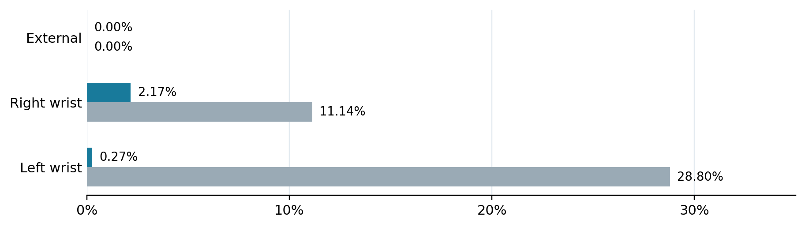

# 2026-10-30_three_camera 原始记录全文转录

来源：[原始 DOCX](2026.10.30R1-A7_三相机细线与镊子实时识别_对话与实验全记录_2026-10-30.docx)。SHA-256：`cf6ee1524d88ccf366614cae321e449012d546cc04bacd64ed394d0a8488f977`。

历史记录中的命令、建议和待办仅供追溯，不是本次操作授权。全文转录保留表格与嵌入图片；原始版式以 DOCX 为准。

R1-A7 双腕机器人 · 三相机视觉感知

细线与镊子实时识别

对话脉络、终端操作、错误排查、实验数据与阶段结论

文档日期  2026年10月30日     实验阶段  Temporal Path Tracker V1

项目工作空间  /home/robot/unitree_sim_isaaclab_threading/r1a7_threading_project

## 一页结论

本轮工作从“实时三相机能识别线和镊子”推进到“识别结果具备帧间路径连续性”。主问题不是目标完全丢失，而是双腕画面中细线的原始最长骨架路径会在完整线与局部线段之间频繁切换。加入半径 7 px 的 Temporal Path Tracker V1 后，同一轮 368 帧验证中的路径长度显著跳变比例明显下降。

| 相机 | Temporal V1 RAW 跳变>35% | Temporal V1 TRACKED 跳变>35% | 阶段判断 |
| --- | --- | --- | --- |
| 外部相机 | 0.00% | 0.00% | 稳定 |
| 右腕相机 | 11.14% | 2.17% | 改善显著；仍有 HOLD/RESET |
| 左腕相机 | 28.80% | 0.27% | 改善显著；仍需核对真实贴线程度 |

现场视觉反馈：黄色原始路径仍会闪烁，红色时序跟踪路径保持连续。该现象与日志所示跳变率下降一致；但“红线看起来稳定”并不能替代独立真值验证，也不能据此直接启动机器人闭环。

## 01  项目目标与验证边界

## 1.1 本次对话的实际目标

在控制台手动移动机械臂的条件下，验证外部相机、右腕相机、左腕相机对细线（wire）和镊子（tool）的实时分割与中心线路径稳定性。

先解决细线骨架短缺口，再解决运动过程的“整条线 / 半条线”闪烁，并保留可复现的指标与异常图像。

本阶段只做视觉观察、记录与离线诊断；未开启自动引导、IK、DDS、LowCmd 或由新视觉脚本控制机械臂。

## 1.2 可确认与不可确认的范围

可确认：对话中已实际运行的命令输出、测试会话目录、统计结果、用户上传的诊断日志以及现场“黄色闪、红色连续”的观察。不可由这些材料确认：机器人本地所有代码的最终 Git diff、未提交文件状态、每帧细线真实端点误差、全部实时帧的原始影像完整保存情况、设备当前状态。

## 02  设备、环境与固定参数

| 项目 | 记录值 | 说明 |
| --- | --- | --- |
| 计算环境 | tv_sam2（Python 3.10.20） | torch 2.3.1+cu121；CUDA；RTX 4070 SUPER |
| OpenCV / SDK | OpenCV 4.11.0；pyorbbecsdk 2.1.1 | 实时三相机取流已实际启动 |
| 外部相机 | USB ZOOM：20685204b12d5283 | /dev/v4l/by-id/...video-index0；1280×720 MJPG@30 |
| 右腕相机 | Orbbec CPCBC53000C5 | 1280×800 RGB@30 |
| 左腕相机 | Orbbec CPCBC530007Z | 1280×800 RGB@30 |
| U-Net checkpoint | unet_train_val_v2_resume/best.pt | 3 类：0 背景；1 细线；2 工具 |
| 实时网络/几何参数 | 强阈值0.86；主簇桥接24 px；断点最大50 px | tile=512；stride=384；所有实验沿用 |
| Temporal V1 | 半径7 px；跳变触发0.35；support≥0.65 | 候选长度跳变≤0.35；HOLD≤2 帧 |

说明：30 FPS 为相机流配置值；日志中约 13–15 FPS 是单路推理速度统计，并非已证实的三路端到端刷新率，也不等于硬件同步采集。

## 03  聊天推动的实施时间线

| 阶段/时间 | 对话触发与操作 | 发现及处理 |
| --- | --- | --- |
| 准备期 | 确立现有 U-Net 三分类模型，三路相机实时观察；用户要求工具也应显示 | 初版只画 wire（class 1）；补充 tool（class 2）蓝色叠加 |
| 骨架断线 | 用户上传骨架不完整、短间隙图片；请求直接给终端指令 | 接入主簇→skeletonize→≤50 px 连接→最长测地路径；生成/覆盖实时脚本 |
| 10/30 14:02 | 第一轮运动稳定性验证，556 帧/路 | 左腕整线忽长忽短，右腕路径波动；WIRE=YES 不代表完整 |
| 第一轮后 | 按 CSV 排序异常帧；尝试对异常 JPG 重新推理 | 重推理结果与现场 CSV 不一致；发现 JPEG 不适合薄线概率诊断 |
| 10/30 14:20 | 增加无损 PNG 与实时 Pwire.npy 保存；第二轮313帧/路 | 双腕严重路径跳变；开始对无损 probability 做空间容差分析 |
| 第二轮诊断 | 对左右腕最差 8 组转换统计 radius=0/3/7 的 Pwire | 多组强支持仍在相邻像素，部分转换确实低支持；选择先试时序关联 |
| 10/30 14:41 | 建立 Temporal Tracker V1；第三轮368帧/路 | 双腕 tracked 路径跳变显著下降；用户确认黄线闪、红线连续 |
| 当前决策 | 暂不改阈值与 U-Net；建议做三组独立重复测试 | 未见三组重复试验、GT 准确率或机器人自动引导的完成证据 |

## 04  软件实现与实际操作过程

## 4.1 三个关键本地程序

| 文件 | 用途及运行事实 |
| --- | --- |
| live_wire_unet_three_camera.py | 三相机 U-Net 分割、tool 叠加、主簇和连通骨架；被后续两个验证脚本作为 base 导入。 |
| live_wire_stability_validation_three_camera.py | 按 R 开始/结束记录；输出 frame_metrics.csv 与 summary.json；保存异常帧、mask、后续增加无损 PNG 和 Pwire.npy。 |
| live_wire_temporal_validation_v1.py | 建立 per-camera TemporalTracker；输出黄色 RAW 与红色 TRACKED；保存 temporal_metrics.csv、summary.json 和异常叠加图。 |

## 4.2 有代表性的终端操作

本轮命令在研究工作空间运行，未要求切换 Git 分支，也未执行 clean/reset。脚本的创建或覆盖前，助手曾要求 cp 备份；用户实际运行的验证脚本和输出已由终端日志证明。

cd /home/robot/unitree_sim_isaaclab_threading/r1a7_threading_projectPYTHONNOUSERSITE=1 /home/robot/miniconda3/envs/tv_sam2/bin/python -m py_compile \  vision_dual_camera/task6_threading/dataset_tools/wire_unet/live_wire_temporal_validation_v1.pyPYTHONNOUSERSITE=1 /home/robot/miniconda3/envs/tv_sam2/bin/python -u \  vision_dual_camera/task6_threading/dataset_tools/wire_unet/live_wire_temporal_validation_v1.py

操作按键：R 启动/停止记录；Q、ESC 或 Ctrl+C 退出。机械臂动作由原有控制台手动执行：静止、左右/上下平移、接近/远离细线、改变腕部姿态与局部遮挡。当前资料不能确认每一次移动的具体关节/笛卡尔位姿或速度轨迹。

## 4.3 原始显示到时序显示的变化

| 显示阶段 | 颜色 | 含义 |
| --- | --- | --- |
| 连通骨架实时版 | 粉红 / 亮红 / 蓝 | 粉红=U-Net 主线像素，亮红=当前帧连通中心路径，蓝=镊子 |
| Temporal V1 | 粉红 / 黄色 / 红色 / 蓝色 | 粉红=当前 wire，黄色=当前帧 raw path，红色=时序 tracked path，蓝=tool |
| Temporal 状态 | INIT、TRACK、RECOVER、HOLD、RESET、LOST | TRACK 直接接受；RECOVER 从当前图像重提取；HOLD 沿用旧路径；RESET 重建状态；LOST 无路径 |

## 05  检测与修复算法

## 5.1 从单帧分割到连接中心路径

RGB × 3 cameras  -> U-Net logits (bg / wire / tool)  -> wire threshold = 0.86  -> keep_main_cluster(bridge = 24 px)  -> skeletonize  -> connect_skeleton_components(max_gap = 50 px)  -> longest_geodesic_path  -> RAW PATH（Temporal 版：黄色）

24 px 主簇桥接用于保留主要线簇；50 px 骨架连接用于跨越有限断点。两者都不能凭空修复大段被 U-Net 判为背景的线。

## 5.2 Temporal Tracker V1 状态规则

| 状态 | 触发机制（当前实现） | 应如何解读 |
| --- | --- | --- |
| INIT | 无上次路径，当前 raw_path 可用 | 建立第一条跟踪路径 |
| TRACK | 当前 raw_path 长度相对上次接受路径跳变≤35% | 直接接受；代码未附加最小空间支持要求 |
| RECOVER | RAW 大跳变；当前 wire 在旧路径7px走廊重提取；支持≥0.65且候选长度跳变≤0.35 | 当前帧有新观测；仍需检查物理身份和端点是否正确 |
| HOLD | 无法 RECOVER，最多复制上次路径2帧 | 仅显示旧结果，绝非当前新测量 |
| RESET | 连续不一致且当前仍有 raw_path | 接受当前原始路径重新开始；可能引入跳变 |
| LOST | 持续不可恢复且无 raw_path | 停止输出路径 |

临时参数均取自当前实验版本；不能据此证明所有姿态、遮挡情况下的真实中心线误差符合后续控制精度要求。

## 06  三轮正式实时测试结果

## 6.1 第一轮：单帧骨架 + 实时统计（14:02）

会话：/home/robot/r1a7_datasets/wire_live_validation/motion_stability_20261030_140255

| 指标 | External | Right wrist | Left wrist |
| --- | --- | --- | --- |
| 处理帧数 | 556 | 556 | 556 |
| WIRE found | 100% | 100% | 100% |
| TOOL found | 100% | 100% | 99.28% |
| PATH found | 100% | 100% | 100% |
| CONNECT rate | 100% | 99.46% | 100% |
| 路径跳变 >35% | 0.00% | 7.73% | 3.06% |
| path jump P95 | 0.0354 | 0.4845 | 0.0452 |
| FPS 中位数 | 15.36 | 14.41 | 14.09 |

现场观察：左腕“完整线 / 半线”间歇切换，但 WIRE 与 PATH found 仍均为 100%。最具代表性的变化为 431→432（309.2→147.6 px）、451→452（303.4→147.6 px）、483→484（280.5→149.0 px）；wire_pixels 同步下降，证实“存在率”无法衡量完整性。

## 6.2 第二轮：无损异常诊断（14:20）

会话：/home/robot/r1a7_datasets/wire_live_validation/motion_stability_20261030_142023

| 指标 | External | Right wrist | Left wrist |
| --- | --- | --- | --- |
| 处理帧数 | 313 | 313 | 313 |
| WIRE found | 100% | 100% | 100% |
| TOOL found | 99.04% | 100% | 100% |
| PATH found / CONNECT | 100% / 100% | 100% / 100% | 100% / 100% |
| 路径跳变 >35% | 0.64% | 17.57% | 15.65% |
| path jump P95 | 0.0504 | 0.7899 | 1.0527 |
| FPS 中位数 | 14.23 | 13.74 | 13.93 |

此轮加入“异常当前帧原始 PNG + 前一帧原始 PNG + 当前/前一帧 live Pwire.npy”的保存链路。异常阈值是路径相对长度变化 >35% 或其他掉线触发，不能直接表示像素级 GT 错误。不同轮次动作不是逐帧同一轨迹，故百分比不应用来作严格因果对照。

## 6.3 第三轮：Temporal V1 同场景 RAW vs TRACKED（14:41）

会话：/home/robot/r1a7_datasets/wire_live_validation/temporal_v1_20261030_144103

| 指标 | External | Right wrist | Left wrist |
| --- | --- | --- | --- |
| 帧数 | 368 | 368 | 368 |
| RAW >35% | 0.00% | 11.14% | 28.80% |
| TRACKED >35% | 0.00% | 2.17% | 0.27% |
| RAW P95 | 0.0498 | 0.5842 | 1.3293 |
| TRACKED P95 | 0.0498 | 0.2447 | 0.1003 |
| TRACK / RECOVER | 100.00% / 0% | 88.86% / 4.08% | 71.20% / 25.54% |
| HOLD / RESET | 0% / 0% | 4.89% / 2.17% | 2.99% / 0.27% |
| LOST | 0% | 0% | 0% |
| FPS 中位数 | 14.81 | 14.44 | 13.15 |

图1  第三轮同一测试流的路径长度显著跳变率（灰色=RAW，蓝色=TRACKED）；后文说明统计口径限制。

视觉反馈：黄色仍有间歇闪烁，而红色连续贴近目标线的观感较好。日志支持“路径长度跳变得到抑制”，尚不能独立证实“所有帧几何路径都正确”。

## 07  关键错误、误判与排查闭环

| 问题/错误 | 实际证据与修正 | 保留的教训 |
| --- | --- | --- |
| 只显示线、不显示镊子 | 初版仅绘制 class 1；将 class 2 tool 提取并以蓝色显示 | 分割输出与可视化输出需逐类核对 |
| 细线骨架存在短缺口 | 主簇后原 mask 无法自动保证路径连续；接入 V3 骨架连接和 geodesic longest path | 区分像素漏检、分量断裂和路径提取问题 |
| WIRE=YES 却半条闪烁 | 两轮中三路存在率接近100%，左/右腕仍有大幅长度跳变 | 存在率≠完整率≠真实定位精度 |
| JPEG 二次推理导致结论失真 | 第一轮日志431=309.2 px，但异常 JPG 重推理431≈147.6 px | 细线诊断必须保存无损原帧和实时 probability |
| 只看零位移 Pwire 容易误判 | 部分事件 radius=0 高置信支持接近0，而 ±7 px 局部支持大幅上升 | 诊断需允许空间位移；仍不能据此证明目标身份 |
| 认为所有坏帧均可时序恢复 | 左腕244→245在7px内高置信支持仅12.86% | 弱检测或较大位移仍存在，HOLD/RESET不能掩盖失败 |
| 红色更稳≠路径完全正确 | Temporal V1的 HOLD 复制历史路径；TRACK按长度阈值直接放行 | 下一步必须做端点、路径几何和目标身份验证 |

## 08  无损 Pwire 诊断：真正证明了什么

使用第二轮异常缓存（非 JPEG 重新推理），对左右腕每路按跳变排序抽查最差 8 个前后帧转换。比较前一帧强细线区域与当前 Pwire，在当前位置及半径3、7 px 的邻域取最大概率，用于评估“当前帧是否仍在附近看到线”。

| 相机 / 帧转换 | radius=0 的观测 | radius=7 的 Pwire≥0.86 | 解释边界 |
| --- | --- | --- | --- |
| 右腕 209→210 | ≥0.86 比例 0.00% | 79.14% | 同坐标几乎不重合，但附近有较强细线证据 |
| 右腕 13→14 | ≥0.86 比例 90.98% | 97.16% | 高置信覆盖仍足，路径仍产生约104%跳变 |
| 左腕 60→61 | ≥0.86 比例 91.67% | 100.00% | 模型仍能看到线，路径选择/关联值得优先改进 |
| 左腕 241→242 | ≥0.86 比例 0.00% | 89.76% | 明显空间错位或几何关联问题 |
| 左腕 244→245 | ≥0.86 比例 0.00% | 12.86% | 仍是低支持的困难事件，不能机械保持旧路径 |

多数转换的影像整体清晰度和亮度差异小，例如左腕60→61的清晰度129.16→129.13、亮度117.55→117.53。这削弱了“所有异常都由整体曝光/模糊引起”的猜测，但并不能排除局部反光、像素位移、局部模糊、目标切换或骨架连接错误。

## 09  指标解释、局限与验收风险

## 9.1 当前真正达成的结论

三路设备在上述三轮验证中成功取流；U-Net 和 tool/wire 的实时显示已在实机手动运动下运行。

骨架短缺口已接入连接算法；Temporal V1 在 368 帧记录中，TRACKED 路径长度 >35% 的相对跳变率下降到右腕2.17%、左腕0.27%。

用户在画面中观察到黄色闪烁而红色连续，和数值趋势一致。

## 9.2 不应被误写为已通过的事项

没有新独立 GT 证明所有运动帧的细线真实中心线完整率、端点误差、镊尖位置精度；当前主要是时序长度统计和视觉观察。

Temporal V1 代码中“raw_jump”使用当前 raw_length 相对前一帧已接受 tracked_length 比较，未必等于严格连续 RAW–RAW 长度差；评估脚本里的 RAW/TRACKED 两列统计口径并非完全对称，必须另算真正的 raw-to-raw 指标。

TRACK 在长度跳变≤35%时并不检查空间位置；不同错误路径可能长度相同。RECOVER 的候选验收也只检验支持率与长度差，未对端点/整条路径匹配做 GT 约束。

HOLD 沿用旧路径 1–2 帧，不能视为新的视觉测量；RESET 接受当前 raw path 也不能自动当成正确物理目标。

临时 V1 脚本异常目录主要保存叠加 PNG，未证明所有 368 帧的原图/预测均无损留存，后续应改善。

当前推理是三相机顺序处理，缺少已验证的硬件同步、端到端采集到显示延迟、轨迹真值及移动速度标定。

## 10  已使用的关键文件与目录

实时模型与显示  /home/robot/unitree_sim_isaaclab_threading/r1a7_threading_project/vision_dual_camera/task6_threading/dataset_tools/wire_unet/live_wire_unet_three_camera.py

第一、二轮稳定性记录程序  /home/robot/unitree_sim_isaaclab_threading/r1a7_threading_project/vision_dual_camera/task6_threading/dataset_tools/wire_unet/live_wire_stability_validation_three_camera.py

第三轮 Temporal V1 程序  /home/robot/unitree_sim_isaaclab_threading/r1a7_threading_project/vision_dual_camera/task6_threading/dataset_tools/wire_unet/live_wire_temporal_validation_v1.py

U-Net 权重  /home/robot/r1a7_datasets/wire_unet/pilot_001/runs/unet_train_val_v2_resume/best.pt

第一轮会话  /home/robot/r1a7_datasets/wire_live_validation/motion_stability_20261030_140255/

第二轮会话  /home/robot/r1a7_datasets/wire_live_validation/motion_stability_20261030_142023/

第三轮会话  /home/robot/r1a7_datasets/wire_live_validation/temporal_v1_20261030_144103/

记录形式：frame_metrics.csv、temporal_metrics.csv、summary.json、anomaly_raw/、anomaly_masks/、anomaly/；本对话中的本机路径来自实验日志，非本次文档生成环境对机器人硬盘进行的现场校验。

## 11  下一阶段测试方案与操作清单

## 11.1 不改参数，先做三组独立重复实验

| 试验 | 手动控制台动作 | 重点验证 |
| --- | --- | --- |
| A. 缓慢平移 | 静止→左右/上下移动→返回→静止 | 路径连续性、时序与空间跟随 |
| B. 接近/远离细线 | 远距离→接近→停留→退回 | 镊尖附近的 wire 完整性和 tool 分割 |
| C. 困难姿态/遮挡 | 改变腕姿态、线倾角、部分遮挡 | RECOVER是否贴线；HOLD/RESET后的真实恢复情况 |

每组按 R 开始/结束记录；结束后退出程序再重新启动，以避免前次跟踪状态影响下一条轨迹。计划每组约40–60秒，目前聊天记录尚未提供这三组独立试验的结果。

## 11.2 建议下一次补齐的数据（比单一跳变率更重要）

单独计算严格 RAW–RAW 和 TRACKED–TRACKED 路径长度变化，确保同一帧序列、同一分母。

增加 per-frame GT 核验：raw/path/tracked 的中心路径到人工可见细线距离（含 ±2 px 容差），并记录整线覆盖率与端点偏差。

对 TRACK / RECOVER / HOLD / RESET 各状态分别抽样人工审查，报告假连接率、错误目标粘连率及 HOLD 假稳定率。

在异常检测及随机样本同时保存原始 PNG、三类 mask、RAW/Tracked path 和实时 Pwire；记录 capture→inference→display 时延。

如果局部真实线段在当前 Pwire 中长期为低支持，再从新的训练集采集低对比、反光、运动模糊、腕部困难视角数据考虑 V5；避免利用已分析的旧 test 作为干净最终留出集。

## 11.3 建议验收阈值与使用边界

可暂用工程筛选门槛：TRACKED长度跳变 >35% 比例低于5%、LOST接近0、HOLD低于5%、RESET低于3%。它们仅是“时序稳定性”预筛选，不是视觉引导充分条件；在缺少 GT 几何、工具尖端和空间标定验证前，不进入自动移动。

## 12  背景研究记录（供回溯，非本轮新实验）

此前同项目已有 pilot_001 三相机数据集：50组×3相机=150幅；train/val/test分别为35/7/8组（105/21/24幅）；三类标签含背景、线、工具，255为ignore。固定划分仅按样本级而非独立场景组，具有相关性限制。

U-Net V2（由V1继续训练）曾在验证集取得 overall foreground mean Dice≈0.7502、wire Dice≈0.5658、tool Dice≈0.9346；wire±2px tolerance F1≈0.9758。V3 连通路径在21/21验证图像构建成功。V4 测试曾发现 right_wrist 000041 的 FREE 端大段漏检，且该 test 已被用于诊断，不宜继续宣称完全独立。

这些背景结果支持选择先改进几何与时序路径，但不能替代本轮运动中新条件下的端到端精度测试。

## 13  对话纪要：需求—回应—证据映射

| 对话诉求 / 反馈 | 对应实施、结果或决定 |
| --- | --- |
| “细线骨架提取不完整，中间有中断” | 引入骨架短间隙连接和最长路径提取；仍限制不能修复模型整段漏检。 |
| “直接给出完善程序终端输入指令” | 提供覆盖/备份实时三相机脚本及 py_compile 和启动命令。 |
| “通过控制台移动，怎么验证效果？” | 设计静止/运动/遮挡测试，并增加 R 控制的逐帧统计与异常抓取。 |
| “开始测试验证运动稳定性” | 第一轮556帧/路；存在率很好但左右腕路径不完整。 |
| “左腕完整线/半线闪烁” | 定位为 mask 及路径长度同步跳变；检查异常帧 431/432、451/452、483/484。 |
| “执行无损概率诊断” | 发现 JPEG 重新推理偏差；补充 PNG 和实时 Pwire 后第二轮313帧。 |
| “开始下一步测试” | 创建 Temporal V1；第三轮368帧，记录 RAW/TRACKED 与状态比例。 |
| “黄色和红色有什么区别？” | 黄色=当前单帧路径；红色=加入历史关联的输出；HOLD 不是新观测。 |
| “黄色还在闪、红色保持连续” | 现场确认时序稳定性改善；下一步建议独立重复及 GT 几何验证。 |

## 14  源记录与版本追溯

主要证据为本聊天中用户粘贴的多次机器人终端输出、三相机截图、用户上传的“粘贴的文本 (1).txt”（含第二轮完整输出和左右腕 Pwire 空间容差诊断）、以及各实验会话目录的终端打印路径。

项目 GitHub 来源仓库：sbboys/r1a7-quest3-vr-teleop-demo；工作基线分支 codex/r1a7-console-camera-suite-2026-10-11；本次对话最近查询的 HEAD 为 8d01fdac3117add7f6d2929f4a45bc0437ef8e13（2026-10-27）。GitHub 的已提交状态不等于机器人本地研究工作区的当前未提交状态。

记录截至 2026-10-30；最后一次实测为 temporal_v1_20261030_144103。随后提出的三组独立复测与引导前 GT 定量验证，尚无本聊天中的完成输出。
