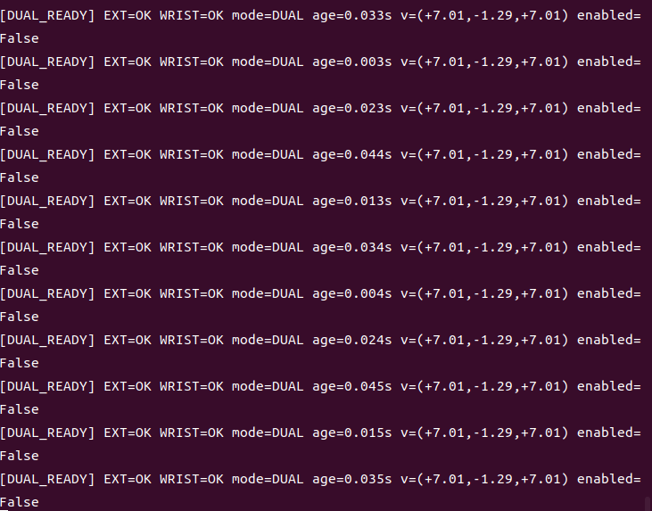

# R1-A7_夹取插孔调试_数据标注模型训练_程序备份_完整对话整理_20261116 全文

[原件](R1-A7_夹取插孔调试_数据标注模型训练_程序备份_完整对话整理_20261116.docx)；SHA-256：`45e2b763995f19286abf2ddad6e94f04f9b403973f1a5e6f22520316228a3322`。

保留历史状态、正文、表格和附注；历史指令不是本次执行请求。当前核对报告单独记录差异。

Unitree R1-A7 双臂机器人

细线夹取与插孔研发调试完整工作记录

从视觉感知、控制门控到同步数据集、模型增量训练与版本归档

对话整理截止：2026 年 11 月 16 日

工作范围：抓取闭环 / 插孔目标检测 / 三相机 U-Net / Fusion-Gate-Controller / 数据采集与标注 / 模型训练 / 程序与 SHA256 备份

| 归档对象 | 当前阶段结论 |
| --- | --- |
| Wire V5（epoch 123） | 已完成训练、冻结、SHA256 校验通过；可作为新孔板细线/镊子视觉候选 |
| Hole V3（epoch 64） | 完成新孔板训练、冻结与三相机现场测试；识别质量仍受灯光、视角、面积阈值影响 |
| Grab→Insertion 控制链 | Visual / Fusion / Gate / Controller 架构保留；Gate 最新日志 enabled=False，运动授权根因未确认 |
| NEW_BOARD_02 | 仅提出第二批采集方案；本对话未提供已经完成采集/标注/训练的证据 |

记录口径：把已执行、终端确认、用户现场反馈、提出但未执行、待验证分开标记。日志、路径和校验值保留到可追溯粒度；本文是技术归档，不等同于“物理夹取成功”或“实际穿孔成功”的证明。

目录

01  总体结论与状态矩阵

02  系统架构、相机与安全边界

03  对话工作时间线

04  抓取感知与控制阶段调试

05  插孔阶段视觉跟踪及 FREE 稳定化

06  自动采集、硬样本与同步分组

07  联合标注体系与旧联合数据

08  Wire V4 / Hole V2 旧孔板基线

09  新孔板 NEW_BOARD_01 采集与标注

10  Hole V3 训练、现场失败与灯光影响

11  Wire V5 增量训练与冻结

12  运行时模型替换与四终端测试

13  Gate enabled=False 最新诊断

14  Controller 暂停／保持当前位姿

15  程序变更与状态标记总览

16  数据、模型、备份、SHA256 归档索引

17  真机运行及回滚检查 SOP

18  未闭环问题与建议优先级

附录 A  本轮重要训练与实时日志摘要

附录 B  关键命令速查

附录 C  证据来源与先前历史归档

目录按主题检索，不采用自动页码目录，避免跨版本排版导致页码错位。

01  总体结论与状态矩阵

截至 2026-11-16，本轮最明确的训练成果是 Wire V5：从冻结的 Wire V4 epoch110 开始，采用 Pilot/Open/旧 Insertion 回放和 NEW_BOARD_01 新场景数据进行联合微调，最佳 epoch123。新孔板 reserved test 的前景平均 Dice 为 0.902626，Wire Dice 为 0.868815，Tweezer Dice 为 0.936436；旧场景三项 guard 均通过。由于新孔板样本来自单次 session，不能将这一结果视为跨场景泛化的证明。

Hole V3 从旧 Hole V2 epoch52 参数初始化，但训练图像/掩码仅使用 NEW_BOARD_01，没有旧孔板 replay。最佳 epoch64：Validation Score 0.705696，Reserved Test Score 0.375648。External 的 test Hole Dice 为 0，后来实时观看出现位置错误/漏检；用户在调整环境灯光后观察到识别明显改善，但没有形成独立场景、长期稳定性验收。

抓取/插孔主程序的 checkpoint 切换脚本已在对话中给出，后续也启动了视觉、Fusion 与 Gate 日志；然而当前对话未展示“路径补丁完成 + 主程序运行日志确认加载 Wire V5/Hole V3”这一完整闭环，所以版本接入应标注为“已给出替换方案、待最终启动回执核实”。

| 模块 | 状态 | 证据与限制 |
| --- | --- | --- |
| Wire V5 | 训练完成 / 冻结 | epoch123；test 0.902626；best.pt SHA256 c72a9…174a4e7；冻结目录已列出 |
| Hole V3 | 训练完成 / 视觉待验收 | epoch64；test 0.375648；viewer 现场从 0/2/0 到在新灯光下有 1/1/1 的短段输出 |
| 抓取顺序门控 | 历史已实现 | EXT 稳定→Wrist 横向→小幅前探→最终就绪→CLOSE；物理夹持仍需现场证据 |
| 插孔目标跟踪 | 部分已实现 | 选孔、per-camera ROI、EMA、HOLD；右腕误选/时序稳定需持续检查 |
| Gate | 待定位 | EXT=OK、WRIST=OK、age 新鲜但 enabled=False；根因未从 Gate 源码/JSON 证明 |
| 手动 PAUSE | 未验证存在 | 已知 CLOSE_SETTLE 自动保持；P/R 人工暂停只是一项建议 |
| NEW_BOARD_02 | 规划中 | 采集命令、无需 scene 强制分组方案已提出；未见采集完成回执 |

02  系统架构、相机与安全边界

2.1 视觉到执行的运行链路

External USB ZOOM: Wire / Tweezer / HoleRight Wrist Orbbec: Wire / open-jaw TIP / HoleLeft Wrist Orbbec: Wire / Hole monitoring             ↓live_grasp_to_insertion_visual_v3.py             ↓wire_grasp_fusion_shadow_v1.py             ↓wire_grasp_control_gate_v1.py             ↓/tmp/r1a7_dual_ibvs_velocity.json             ↓Cartesian stream / IK / LowCmd Controller             ↓R1-A7 右臂抓取与插孔

2.2 相机设备及作用

| 视角 | 设备 / 标识 | 主要任务 |
| --- | --- | --- |
| External | ALP USB ZOOM；/dev/v4l/by-id/usb-ALP_USB_ZOOM_Camera_20685204b12d5283-video-index0；1280×720@30 MJPG | 抓取 X/Z 视觉主导、近距离 Z 优先；插孔时可作为控制相机 |
| Right Wrist | Orbbec，CPCBC53000C5；1280×800@30 RGB | 夹爪双尖端 TIP、横向校准、抓取 CLOSE 准备；插孔时主候选控制相机 |
| Left Wrist | Orbbec，CPCBC530007Z；1280×800@30 RGB | 插孔视觉监视、数据覆盖；不能单独启动插孔 |

2.3 控制安全原则

必须只有一个独立 LowCmd 发布者；同一命令行显示多个 PID 时先检查 multiprocessing 亲子关系，不能简单按进程数判断冲突。

物理急停是首要安全手段；不能把 Ctrl+C、kill 或 Gate enabled=False 等同于机器人主动保持位置。

正常退出时先停 Controller 并确认 LowCmd 已停止，再停 Gate、Fusion、Visual；不手工删除 /tmp/r1a7_vr_g1ik_real.lock。

视觉-only、离线标注和训练不得启动 Gate/Fusion/Controller/LowCmd；真实闭环测试先完成模型及目标有效性检查。

日志“抓取就绪”“完成 CLOSE”只能证明软件状态变化，不能单独证明物理夹紧细线或成功穿孔。

03  对话工作时间线

| 阶段/日期 | 任务 | 结果 / 证据状态 |
| --- | --- | --- |
| 11 月初 | 三相机 U-Net、FREE/GRASP 几何、右腕张开镊子 TIP 与抓取自动闭合 | 旧文档归档；包括 Right Wrist OPEN 数据、Wire V3 与 Jaw Corridor |
| 11/07—11/09 | Gate 350 px hard stop、Fusion BLIND_GRACE、External-near Z 主导、序列式 CLOSE 校验 | 代码标记及部分备份位置明确；部分逻辑用户曾反馈正常 |
| 11/10 | Insertion Dataset Recorder 接入并自动同步记录三相机 | 197 组 / 591 张 / 197 records；统计完整 |
| 11/11 | 旧联合插孔数据 35 组标注、split、Wire V4 / Hole V2 增量训练 | 旧 test 比较及冻结模型 / SHA256 完成 |
| 11/12—11/13 | 建立 /data/threading 实验中心及 NEW_BOARD_01 最终孔板采集、标注 | 21 组 / 63 张；最终审计 PASS；18M 标注归档 |
| 11/14 | Hole V3：新板数据训练；Wire V5：新旧 Wire Replay | Hole V3 test 低；Wire V5 test 高，冻结检查通过 |
| 11/14—11/15 | 修改 Visual V3 模型路径方案、三相机 Hole Viewer 检查 | Hole 面积阈值 15→1 诊断、三相机错检/闪烁；单孔后处理仅建议 |
| 11/15—11/16 | 用户观察灯光改善；决定不增采，转现有模型进行夹取插孔测试 | 提出仅替换 checkpoint，保持 Fusion/Gate/Controller 不变 |
| 11/16 | Gate DUAL_READY 但 enabled=False；讨论 Controller 暂停保持 | Gate 根因尚未确认；可确认自动 CLOSE_SETTLE_HOLD，人工 P/R 未确认 |

04  抓取感知与控制阶段调试

4.1 关键困难及设计目标

细线和镊尖像素尺寸小、遮挡和反光明显；直接使用单帧 GRASP 对准误差会出现跳动，导致控制丢失或过早 CLOSE。抓取目标始终是多轴复合运动，不能把整个抓取路径粗暴改成 X、Y、Z 逐轴串行。精细结束阶段可以采取分阶段资格判断。

4.2 已实现或历史确认的抓取优化

| 改动 / 标记 | 内容 | 重要参数或边界 |
| --- | --- | --- |
| DISABLE_IMAGE_ERROR_HARD_GATE_TREND_V1 | 取消 Gate 的 350 px 图像误差硬停止 | 不能因此推断 enabled=False 的其他授权条件已满足 |
| BLIND_GRACE | 短时视觉丢失时保守控制 | grace 0.40 s、scale 0.40、速度上限 2 mm/s |
| GRASP_EXTERNAL_NEAR_Z_PRIORITY_V1 | 远处 Z 由 External/Wrist 加权，近距离 Z 使用 External | 进入近距 <=45 px，退出 >=65 px；远处 Z=0.35E+0.65W |
| WRIST_JAW_CORRIDOR_V1 | OPEN 双尖端间距学习，夹取目标位于镊口中间 80% 即可 | 有效样本 12；每 blade component >=80 px；次分量比例 >=0.20；尖端间隔 >=8 px |
| JAW_CORRIDOR_CLOSE_LATCH_V1 | 符合 corridor 后单向锁存，规避短时定位漂移 | _JAW_CORRIDOR_LATCHED 在当前进程生命期不反向清零 |
| GRASP_SEQ_EXT_REACQUIRE_V1 | EXT 近距稳定→腕部横向稳定→前探→最终核验 | EXT <=10px 持续 0.20s；前探前若 EXT >16px 复位 |
| WRIST_LATERAL_ONLY_READY_V1 | Right Wrist 仅判断夹口横向误差作为前探资格 | 横向/&#124;du&#124; <=8px 持续 0.20s |
| FINAL_NEAR_TIP_DISTANCE_GATE_V1 | 最终靠近尖端并复核，再允许 close | 最终夹口及 &#124;du&#124; <=8px，tip distance <=22px |
| GRASP_FORWARD_NUDGE | 夹取末端沿前向微移 | 触发 12px，移动 5mm，1mm/s，最低可学习 vx 0.15mm/s |

4.3 CLOSE_SETTLE / WAIT_CONTACT 状态

Controller 由 OPEN_TRACKING 进入 CLOSE_SETTLE 后，保持当前 Cartesian 目标，零速度保持约 0.40s，随后执行一次 CLOSE，进入 WAIT_CONTACT，最后才可能 DONE。进入 close 的条件应包含 Fusion 的 grasp_close_ready=True 与 grasp_sequence_stage==READY_TO_CLOSE，以及右腕 corridor latch。这里的 enabled=True + v=0 属于“主动保持”，与 Gate 输出 enabled=False 不同。

调试记录中特别强调：外部近距切换、Jaw Corridor 与 sequential readiness 的分级判断已经降低单帧波动敏感性，但实际夹持、丝线是否进入镊口，仍须以现场画面和机械状态验证。

4.4 已提出、需确认的改动

FINAL_ADJUST_ONLY_AUTHORITY_V1、FINAL_ADJUST_LATCH_RESET_V1、COMPOSITE_STAGE_DIAGNOSTIC_V1 等标记曾用于控制权及阶段诊断；历史 py_compile 曾通过，但不能把编译通过直接作为真机性能验证。

05  插孔阶段视觉跟踪、选孔与 FREE 稳定化

5.1 插孔状态机

GRASP  | 真实 CLOSE / WAIT_CONTACT  vWAIT_HOLE_TARGET  | 手工点选目标孔，至少一个控制相机目标有效  vINSERTION_TRACKING  | 感知 → Fusion → Gate → Controller  v低速插孔 / 失败则停止或重新选孔

控制相机为 External 和 Right Wrist；Left Wrist 是可选监控。仅 Left Wrist 有 selected/target_valid 不应启动插孔。用户希望“一个控制相机有效即可”，这已经以 OPTIONAL_CONTROL_CAMERA_HOLE_SELECTION_V1 记录于源码。

5.2 孔位跟踪与 FREE 跟踪参数

| 对象 | 参数 | 当前值 / 说明 |
| --- | --- | --- |
| 孔候选 | HOLE_TILE / HOLE_STRIDE | 512 / 384 |
| 孔连通域 | HOLE_MIN_AREA / MAX_AREA | 完整 Visual 默认 15 / 5000；Viewer 试验分别用过 15 和 1 |
| 孔跟踪 E | ROI radius / jump / EMA | 50 px / 25 px / 0.15 |
| 孔跟踪 RW | ROI radius / jump / EMA | 90 px / 55 px / 0.45 |
| 孔跟踪 LW | ROI radius / jump / EMA | 75 px / 45 px / 0.30 |
| 孔跟踪时效 | HOLD / FRESH | 0.80 s / 0.80 s |
| FREE | EMA / max jump | 0.20 / 35 px |
| FREE fallback | 最大 age / speed scale | 0.50 s / 0.40 |
| FREE control hold | 保持时长 / speed scale | 0.25 s / 0.20 |
| 模型推理 | HOLE_EVERY | 视觉 loop 每 2 次运行一次 Hole 推理（CLOSE 后） |

5.3 未闭环故障

右腕相机随机械臂移动时，孔位在画面中变化快；早期“用平滑后的 target 再做下一帧 ROI 中心”可能增加滞后。曾提出 DYNAMIC_SELECTED_HOLE_TRACK_V1 采用原始观测中心辅助 ROI、EMA 输出用于控制；本轮源码显示 per-camera jump/ROI/EMA 参数存在，但不能仅凭参数证明解耦策略已经完整生效。

在 INSERTION_TRACKING 期间曾出现“FREE-HOLD、有像素误差但手臂不动”；需要同一时间戳的 perception、target state、velocity JSON、Gate 和 Controller 日志才可区分 FREE stale、Fusion suppression 与 Gate disabled。

曾提出 WAIT_HOLE_TARGET 中按 1/2/3/N 重新选择 External / Right Wrist / Left Wrist / 全部相机；没有对应已成功打补丁的终端回执，不应作为现成操作说明。

06  自动采集、硬样本分析与同步分组

6.1 Insertion recorder

新增 insertion_dataset_recorder_v1.py 并集成到 live_grasp_to_insertion_visual_v3.py，标记 INSERTION_DATASET_RECORDER_INTEGRATION_V1；训练/采集与机器人控制为不同责任层，录制代码本身不产生 LowCmd。

| 指标 | 首次真实会话结果 |
| --- | --- |
| Raw session | /home/robot/r1a7_datasets/wire_unet/insertion_runtime_001/raw_sessions/20261110_152101_491 |
| 同步 triplet | 197 组（三路一致） |
| 图片 / records / 大小 | 591 张 / 197 条 / 约 159 MB |
| External FREE | DISPLAY_ONLY 159；MEASURED 34；TIP_RELATIVE_PRED 4 |
| Right Wrist | MEASURED 161；DISPLAY_ONLY 36 |
| Left Wrist | DISPLAY_ONLY 166；MEASURED 29；TIP_RELATIVE_PRED 2 |
| 事件高频 | RW GUIDANCE_INVALID 178；E GUIDANCE_INVALID 161；SINGLE_VIEW 155；FUSION_STOP 146；GATE_DISABLED 117 |

6.2 同步 group 筛选

通过 insertion_hard_sample_analyzer_v1.py 和 insertion_sync_group_dedup_v1.py 从 raw session 中筛选 35 个同步 group（105 张图）；WAIT 10 组、INSERTION 25 组，min time gap 约 0.811 s。后续数据划分按 group 同步处理，不能将同一时间点三路图分到不同 split。

OLD joint grouped seed44：train 25 groups（75 图）、validation 5 groups（15 图）、test 5 groups（15 图）。初期使用独立图片去重，随后修改为同步 group 去重，避免跨相机时间关联泄漏。

6.3 数据中心组织

/data/threading/  experiments/          # 试验快照与回执  raw_sessions/         # 同步原始采集  analysis/             # 分析输出  reports/              # 报告  archives/             # 数据归档  new_board_dataset/    # 新孔板数据及模型  current_trial.txt

在 20261112_194018_trial01 下建立试验快照、源码/模型校验。录制程序支持通过 R1A7_INSERTION_DATASET_ROOT 环境变量切换保存根目录；本轮没有提供向 /data/threading/raw_sessions 实际写入成功的最终回执。

07  联合标注体系与旧联合数据

7.1 标注语义与双掩码原则

同一 RGB 图像同时标 Wire 与 Hole，但保留两张独立单通道 mask，不能合并：Wire mask 中 0=背景、1=细线、2=镊子/工具、255=忽略；Hole mask 中 0=背景、1=孔板、2=目标孔、255=忽略。二者类别 ID 相同但语义不同，必须存入 masks_wire 与 masks_hole。

联合标注脚本 annotate_insertion_joint_v1.py；常用按键：L=Wire，T=Tweezer，B=Board，R=三点参考孔，H=自动孔，E=手工孔，Enter=确认，U=撤销，K=保存，N/J=前后切换，Z/X=缩放，WASD=平移，Q=退出。

7.2 旧联合插孔数据 audit

| 项目 | 结果 |
| --- | --- |
| 数据根目录 | /home/robot/r1a7_datasets/wire_unet/insertion_joint_001 |
| 同步组 / 图像 | 35 / 105 |
| 文件 / shape / label | missing 0；bad_shapes 0；bad_values 0 |
| 标注完整性 | wire_nonempty 105；hole_nonempty 104；geometry_records 105；geometry_missing 0 |
| Wire class pixel | 0:103,587,660；1:135,831；2:212,509 |
| Hole class pixel | 0:99,673,677；1:4,106,933；2:155,390 |
| 审计结论 | JOINT_ANNOTATION_DATASET_OK |

最终旧数据归档：insertion_joint_annotation_complete_20261111_165043.tar.gz；SHA256 9ad042afbb39543ec8deaa1c5d80512f8335fb2bbe6e9c18b237b82540334321。split SHA256 79954f512838a8df0ce0c6cf9eb8c52a9817741ed6ec474d6df1ffdbe7bd59bc。

08  Wire V4 / Hole V2 旧孔板历史基线

8.1 Wire V4：保留旧场景、增加旧插孔 replay

训练器 train_wire_unet_v4_insertion_joint.py，初始化 Wire V3 epoch90。Pilot×1、Open×1、Insertion×3；lr=1e-5，epochs=20，batch=2，crop=512，validation stride=384。旧验证的加权指标：Pilot 0.20、Open 0.25、Insertion 0.55；Pilot/Open 最大退化 0.03。

| 验证/测试域 | V3 | V4 epoch110 | 结论 |
| --- | --- | --- | --- |
| 旧验证综合 | 0.677249 | 0.782795 | 改善 |
| Reserved Pilot test | 0.756371 | 0.744155 | 下降 0.012216 |
| Reserved Open test | 0.728989 | 0.734124 | 提升 0.005135 |
| Reserved Insertion test | 0.623970 | 0.849347 | 提升 0.225377 |
| Insertion External / RW / LW | V3 分别 0.622687 / 0.660550 / 0.519603 | V4 分别 0.842285 / 0.837460 / 0.870559 | 全部改善 |

V4 冻结 checkpoint：/home/robot/r1a7_datasets/wire_unet/insertion_joint_001/frozen/models/wire_v4_insertion_replay_seed44_epoch110.pt；SHA256 31dcc17b4353be524af6bd75613ecf8802745ad0a2f07fdc1bb19d0587be88d7。

8.2 Hole V2：旧孔板 replay 的历史模型

训练器 train_hole_board_unet_v2_insertion_replay.py，初始化 Hole V1 epoch38。old unique72/new75、new repeat3，混合 297 条样本；最好 epoch52。旧 test mean foreground Dice：V1 0.829813→V2 0.825648，下降 0.004165；插孔 test：0.661087→0.796365。旧 External board Dice 有 0.9312→0.8156 的退化风险。

V2 冻结 checkpoint：/home/robot/r1a7_datasets/wire_unet/insertion_joint_001/frozen/models/hole_v2_insertion_replay_seed44_epoch52.pt；SHA256 467c57b3e74f9b885013bc8c0a77a3881fad53283d0325b2e0ba3f450d0a6b52。

后来实际插孔目标更换为不同物理结构和不同孔径的新孔板；Hole V2 在新物体上的 External 只能检出约 2 个候选，两个腕部几乎检不出，因而转入 NEW_BOARD_01 新域适配。

09  NEW_BOARD_01 采集、标注和最终归档

9.1 最终目标孔板和会话

NEW_BOARD_01 是用于最终插孔的全新物理孔板，不是旧孔板的另一个姿态；由手动三相机采集脚本 manual_newboard_hole_capture_v1.py 保存 21 个同步组，每个相机 21 张，合计 63 张，全部 scene_000。

/data/threading/new_board_dataset/manual_capture/NEW_BOARD_01/  20261113_102305_manual01/    images/{external,right_wrist,left_wrist}/    metadata/ notes/ previews//data/threading/current_new_board_session.txt  # 指向当次会话（后续可能改写）

采集用户界面按键：S=保存同步组，R=递增 scene，U=撤销，P=统计，Q=退出。部分 S 因轻微负 age/skew 约束被拒绝；已接受 21 组 skew 约 1.85—28.28 ms。全部 scene_000意味着近重复和训练/验证泄漏风险，已明确标识为 pilot。

9.2 联合标注及第 3 组补标

新板标注 root：/data/threading/new_board_dataset/annotation/NEW_BOARD_01；images_raw 软链接至原图，masks_wire、masks_hole、annotations_joint 与预览分别保存。标注共 63 张完成。External/group_000003 初始只完成 Wire，2026-11-13 20:50:30 单独补标 Tweezer、Board 和参考孔，右腕/左腕该组不变。

| External/group_000003 | 补标结果 |
| --- | --- |
| Wire mask | Wire class1 1,630 px；Tweezer class2 3,290 px |
| Hole mask | Board class1 1,032 px；Hole class2 41 px |
| Hole geometry | center_uv (307,457)；axes_px (5.0,2.2361)；method reference_3point |

9.3 最终 audit

| 相机 | 图像/掩码 | Wire / Tweezer px | Board / Hole px |
| --- | --- | --- | --- |
| External | 21 / 21 | 30,194 / 65,945 | 20,138 / 757 |
| Right Wrist | 21 / 21 | 19,533 / 41,976 | 65,453 / 1,293 |
| Left Wrist | 21 / 21 | 27,656 / 70,373 | 47,594 / 848 |

最终 audit_v2：missing_files=[]、bad_shapes=[]、bad_values=[]、empty_classes=[]；annotation_log_coverage=63、geometry_log_coverage=63、camera_image_sets_match=true、audit_pass=true。历史 annotation_log 有 65 行（重复保存形成的历史记录），不必删除，审计按最新 key 使用。

最终归档：/data/threading/new_board_dataset/archives/NEW_BOARD_01/NEW_BOARD_01_annotation_final_20261113_210547.tar.gz（18 MB）；SHA256 462288ecc3ba00c1f6c63d6b6cbd3f9eab120a1b98135966b531a435fa95c9f4。

10  Hole V3 训练、三相机问题与灯光影响

10.1 训练口径与 split

Hole V3 仅训练 NEW_BOARD_01 图像/掩码；没有旧孔板数据 replay，但通过 --resume 加载旧 Hole V2 权重进行迁移学习。因此“数据只用新孔板”不等于“网络从零训练”。第一轮 grouped-timeblock split：train 前 15 组 / 45 图，val 第 16–18 组 / 9 图，test 第 19–21 组 / 9 图；全部 scene_000，只能视为 pilot。

Trainer: vision_dual_camera/task6_threading/dataset_tools/hole_unet/         train_hole_board_unet_v3_newboard.pyRuntime: /data/threading/new_board_dataset/training/hole_v3_newboard/newboard_runtimeRun:     /data/threading/new_board_dataset/training/hole_v3_newboard/runs/hole_v3_newboard_pilot01Resume:  .../hole_v2_insertion_replay_seed44_epoch52.ptepochs=20, batch=2, crop=512, lr=1e-5, repeat(newboard)=3

10.2 训练与 reserved test

| 指标 | 结果 |
| --- | --- |
| 实际 epoch | 53–72（源 epoch52），best epoch64 |
| Train | 135 个 items、67 batches/epoch，CUDA RTX 4070 SUPER |
| Val score | 0.7056957629；Val Board Dice 0.836194；Hole Dice 0.682667 |
| Val per-camera Hole Dice | External 0.0200；Right Wrist 0.758824；Left Wrist 0.812903 |
| Reserved Test score | 0.3756477976；Test Board Dice 0.629167；Hole Dice 0.330909 |
| Test per-camera Hole Dice | External 0.0000；Right Wrist 0.456929；Left Wrist 0.389610 |
| Checkpoint SHA256 | 4ec3923e49e12925520985b8b331c465d24c44bf14dce89107984fd9d6685763 |

训练 RC=0，训练摘要标记 test_used_for_training=false、test_used_for_model_selection=false；但 test 已在训练后评估并被读过，后续不能再作为“未被观察的独立 test”。该 21 组同 scene 的实验没有跨 session 泛化证据。

10.3 实时 Viewer：面积阈值与三相机不同错误

Viewer：live_hole_board_unet_three_camera_v1.py，Hole checkpoint epoch64，tile512/stride384。原设 min-hole-area=15，max=5000 时 fps 约 2.85–3.42，日志连续显示 External=0、Right Wrist=2/3、Left Wrist=0。说明采集的每帧只有一个物理孔，并不代表所有检测到的候选都是真孔。

改用 min-hole-area=1、max=500 后，早期测试出现 External=1/2/0、Right Wrist=2/3、Left Wrist=0/1。用户目视确认：External 检出位置经常不在真孔上；Right Wrist 有 1 真孔及多个假孔；Left Wrist 有时位置准确但闪烁。后一次在改善灯光后，约 3.08–3.65 fps，数量呈 External=0/1/2、Right Wrist=0/1、Left Wrist=0/1，用户反馈效果明显好很多，推测灯光是重要因素。

10.4 连通域算法核查与不采用的粗暴补丁

extract_hole_centers(mask,min_area,max_area) 直接把 mask==2 传入 connectedComponentsWithStats(connectivity=8)，逐连通域按面积过滤并返回全部中心；没有 Board 约束、近邻碎片合并、单孔先验、人工身份锁定等后处理。在对话中给出了 SINGLE_HOLE_TARGET_V1 的可选补丁，但用户没有返回打补丁/编译/回归结果，因此标记为“仅提议、未确认实施”。

不能因为真实世界只有 1 个孔就全局“只留最大连通域”：External 假阳性可能被锁为唯一候选。更合理的是结合 Board 约束、人工选择真实孔、锁定前一目标 ROI、时序连续性，以及必要时增加弱预测孔的视觉置信度评估。

10.5 是否继续采集：决策演变

曾建议采 NEW_BOARD_02：60–90 同步组、至少几个不同 scene，重点覆盖 External 反光/错检、Right Wrist 多候选、Left Wrist 闪烁；用户明确无法准确划分 4 个 scene，方案改为不强制 R 切换、单 scene 连续采样、后续按时间和图像近重复分组。此后用户表示现场灯光改善，希望暂停增量采集，直接用现有 Hole V3 做夹取插孔测试。没有任何 NEW_BOARD_02 已实际采集完毕的终端回执。

11  Wire V5 新孔板增量训练与冻结

11.1 训练数据与旧模型保护

Wire V5 不同于 Hole V3：细线与镊子的语义没有换物体，因此新板图像只增加背景/姿态覆盖，应该继续 replay 原 Pilot/Open/Insertion，避免遗忘。训练器 train_wire_unet_v5_newboard.py 是从 V4 逻辑扩展的独立文件；V4 源文件保留。

| 训练源 | Repeat | 选模权重 |
| --- | --- | --- |
| Pilot | 1 | 0.15 |
| Right Wrist Open | 1 | 0.20 |
| Old Insertion | 3 | 0.30 |
| NEW_BOARD_01 | 3 | 0.35 |

Pilot/Open/Insertion 的 guard floor 均为对应 V4 baseline−0.03；NewBoard floor=V4 newboard baseline（不得下降）。训练 run：/data/threading/new_board_dataset/training/wire_v5_newboard/runs/wire_v5_newboard_pilot01。参数：20 epochs、batch2、crop512、stride384、lr1e-5、weight_decay1e-4、seed44。

11.2 结果：最佳 epoch123

| 域 | Wire V4 baseline | Wire V5 best | 变化 |
| --- | --- | --- | --- |
| Pilot val | 0.738180 | 0.743566 | +0.005386 |
| Open val | 0.748463 | 0.758324 | +0.009861 |
| Old Insertion val | 0.814625 | 0.834641 | +0.020016 |
| NEW_BOARD val | 0.790264 | 0.893297 | +0.103033 |
| Combined score | 0.781399 | 0.826246 | +0.044847 |

训练 512 items / 256 batches/epoch；epoch111–130 四个 guard 始终 1111，best 记录为 wire_v5_training、epoch123。最终 NEW_BOARD reserved test Mean FG Dice=0.902626，Wire Dice=0.868815，Tweezer Dice=0.936436；per camera mean FG：External 0.910692、Right Wrist 0.887812、Left Wrist 0.903536。

11.3 训练与冻结存档

Original best:/data/threading/new_board_dataset/training/wire_v5_newboard/runs/  wire_v5_newboard_pilot01/best.ptFrozen:/data/threading/new_board_dataset/frozen/models/  wire_v5_newboard_seed44_epoch123.ptReports:/data/threading/new_board_dataset/frozen/reports/wire_v5_epoch123/  training_summary.json, best_metrics.json,  newboard_test_metrics.json, train_console.log

冻结文件的 SHA256 与训练 best.pt 一致，已经过用户终端核验：c72a9f40c4890094a33db2ed3f50da54e5e7ce5ebb11c56ed906d6b3d174a4e7。该模型可作为候选运行时 Wire 模型，但目前没有充分现场证据支持“任意灯光、距离和抓取状态都稳定”。

12  运行时模型替换与四终端联调

12.1 最小变更：仅替换 checkpoint

用户明确要求继续夹取插孔测试，同时其他程序保持不变。所给补丁只将 live_grasp_to_insertion_visual_v3.py 中 WIRE_V4_CHECKPOINT 的实际路径指向 Wire V5、HOLE_CHECKPOINT 指向 Hole V3；保留变量名避免牵动调用处。补丁包含锚点唯一性检查、时间戳备份以及 py_compile。

WIRE_V4_CHECKPOINT →/data/threading/new_board_dataset/frozen/models/wire_v5_newboard_seed44_epoch123.ptHOLE_CHECKPOINT →/data/threading/new_board_dataset/frozen/models/hole_v3_newboard_seed44_epoch64.pt

来源代码显示：Hole U-Net 在 GRASP 完成 CLOSE 后才 lazy-load，因此纯启动 Visual 时只看到 Wire 模型正常，不能据此证明 Hole 已加载。对话中提供了两个模型的独立加载验证命令，但没有收到最终“MODEL_COMPATIBILITY_PASS + Visual 实际模型加载日志”的回执。

12.2 固定运行入口和顺序

| 终端 | 程序 | 功能 |
| --- | --- | --- |
| 1 | vision_dual_camera/task6_threading/dataset_tools/wire_unet/live_grasp_to_insertion_visual_v3.py | Wire/Hole/TIP/FREE/目标孔及可视化 |
| 2 | vision_dual_camera/task6_threading/perception/wire/proposed/r1a7_wire/wire_grasp_fusion_shadow_v1.py | 两路误差融合与建议速度 |
| 3 | vision_dual_camera/task6_threading/perception/wire/proposed/r1a7_wire/wire_grasp_control_gate_v1.py | 最后运动许可和零/非零速度输出 |
| 4 | transfer_control/experimental/r1a7_cartesian_stream_control_kd30_posvel_wu_dqik_u010_auto_grasp_direct_v1.py | 笛卡尔控制 / IK / LowCmd；必须最后启动 |

12.3 真实接入时的边界

完整 Visual 中 HOLE_MIN_AREA 仍为 15，而实时 viewer 灯光改善后的有效检测使用 min-hole-area 1；只换模型并不自动改完整程序的后处理阈值。WAIT_HOLE_TARGET 无孔时先检查此差异，不能直接让 Gate 放行。

Right Wrist 若真实孔可点击且 target_valid 持续，可作为优先候选；External 错孔或两候选不可点选；Left Wrist 仅监控。

只替换 checkpoint 不等于兼容性验证完成；需要记录每路模型 epoch、代码 hash、当前文件路径和同时间戳状态 JSON。

13  Gate 显示 enabled=False：最新问题定位

13.1 最新屏幕日志

Visual: [GRASP] EXT valid=True WRIST valid=TrueFusion: [DUAL] EXT=OK WRIST=OK        proposed=(+7.01,-1.31,+7.01) mm/s        EXT_ERR≈252.4 px  Z=DUALGate:   [DUAL_READY] EXT=OK WRIST=OK mode=DUAL        age≈0.003—0.045 s        v=(+7.01,-1.29,+7.01) enabled=False

以上说明：相机状态有效、Fusion 计算过建议速度、Gate 收到新鲜速度，但最终授权没有放行。“False”是布尔值 enabled=False，不能解读为程序异常退出，也不能简单断言来自模型漏检。

13.2 已能排除 / 尚不能确定

| 判断 | 结论 |
| --- | --- |
| 没有视觉输入？ | 不符合日志；EXT / WRIST 均 OK |
| Fusion 没有生成速度？ | 不符合日志；有约 (7,-1.3,7) mm/s 建议 |
| 数据 stale？ | 不符合展示的 0.003–0.045 s age |
| 仍被历史 350 px hard stop 拦截？ | 该 hard gate 历史上已移除；EXT_ERR 252 也低于 350 |
| Gate 哪个最终条件导致 False？ | 未确认；需结合 Gate enable 源码和同时间 JSON |
| 直接将 False 改成 True？ | 禁止；会绕过控制授权/安全判断 |

13.3 待执行诊断

已建议 grep Gate 的 enabled/STOP/READY/phase/reason 条件，读取 /tmp/r1a7*.json，确认 Controller 真正启动及仅一个 LowCmd 发布者。对话没有这些输出，故不应把 False 的根因写成某个确定 flag。建议采集同一时间戳的 Fusion output、Gate output、Controller log 和 phase 信息后再修复。

图 1  用户现场 Gate 终端截图：DUAL_READY、速度字段和 enabled=False 同时出现。

14  Controller 暂停与保持当前位姿

用户询问 Controller 是否存在可以暂停机器人运动并保持当前状态的操作。历史控制逻辑可确认 CLOSE_SETTLE 自动 HOLD：进入夹取闭合短暂静置阶段，冻结 Cartesian 目标、使速度为 0、保持 active controller/LowCmd。这种内部状态是程序自动进入，并非任意阶段人工可触发的暂停。

| 概念 | 是否等于主动保持 | 说明 |
| --- | --- | --- |
| CLOSE_SETTLE_HOLD | 是（限状态机阶段） | Controller 继续运行，Cartesian target 不再推进；enabled=True、v≈0 |
| Gate enabled=False | 不能直接等同 | 表明 Gate 未给运动许可；Controller 对其如何处理需要核查源码 |
| Ctrl+C 或 kill Controller | 不是 | 停止控制进程，不应假设还能主动保持同一姿态 |
| P=PAUSE / R=RESUME | 提议，未实现/未验证 | 建议新增“保存当前目标、持续保持 LowCmd、恢复前重新校验数据”功能 |

下一步应当先 grep Controller 中 PAUSE、HOLD、termios、select、stdin、key event、enabled/zero velocity 相关代码；用户没有提交该 grep 结果，人工按键功能暂不能认定存在。物理异常始终优先急停，人工 HOLD 不是急停替代品。

15  程序变更与状态标记总览

| 文件/模块 | 本轮涉及改动 | 状态 |
| --- | --- | --- |
| live_grasp_to_insertion_visual_v3.py | 插孔 recorder；相机孔选择；动态 ROI/EMA 参数；模型路径 V4/V2→V5/V3 | recorder/选择参数已在源码展示；模型路径补丁运行结果需核实 |
| wire_grasp_fusion_shadow_v1.py | BLIND_GRACE、Z 主导、序列式 close、final adjust、复合运动诊断 | 多项历史实现；现源码不能逐项完全重验 |
| wire_grasp_control_gate_v1.py | 去除 350px hard gate；DUAL_READY 运动使能 | 历史更改；当前 enabled=False 原因未查明 |
| r1a7_cartesian_stream_control_...auto_grasp_direct_v1.py | CLOSE_SETTLE_HOLD、CLOSE latch、状态机 | 自动 HOLD 历史确认；人工 PAUSE 未证实 |
| insertion_dataset_recorder_v1.py | 同步三相机、记录事件及状态 | 首次 197 同步组验证 |
| insertion_hard_sample_analyzer_v1.py | 按异常/状态提取 hard samples | 旧 35 组数据阶段使用 |
| insertion_sync_group_dedup_v1.py | 从图片去重过渡到 group 去重 | 旧 35 组与 split 验证 |
| annotate_insertion_joint_v1.py | Wire+Tweezer+Board+Hole 同图双 mask | 旧联合数据、新孔板完成标注 |
| manual_newboard_hole_capture_v1.py | S/R/U/P/Q 三相机同步手动采集 | NEW_BOARD_01 21 组；NEW_BOARD_02 只规划 |
| train_hole_board_unet_v3_newboard.py | 新板 only + V2 初始化 | 已训练完成 epoch64 |
| train_wire_unet_v5_newboard.py | 旧域 replay + 新板增量 + 四域 guard | 已训练完成 epoch123 |
| live_hole_board_unet_three_camera_v1.py | 实时 viewer / 连通域提取检查 | 真实运行；single-hole patch 未确认实施 |

注意：曾建议的 SINGLE_HOLE_TARGET_V1、Board gate、专用 WAIT_HOLE_TARGET 视觉入口、按键重选孔及 P/R 人工暂停，都属于方案或代码段，不能根据对话直接标记为“已部署”。

16  数据、模型、备份与 SHA256 归档索引

16.1 关键 checkpoints

| 版本 | 文件路径 | SHA256（省略时另见正文） |
| --- | --- | --- |
| Wire V4 | /home/robot/r1a7_datasets/wire_unet/insertion_joint_001/frozen/models/wire_v4_insertion_replay_seed44_epoch110.pt | 31dcc17b4353be524af6bd75613ecf8802745ad0a2f07fdc1bb19d0587be88d7 |
| Hole V2 | /home/robot/r1a7_datasets/wire_unet/insertion_joint_001/frozen/models/hole_v2_insertion_replay_seed44_epoch52.pt | 467c57b3e74f9b885013bc8c0a77a3881fad53283d0325b2e0ba3f450d0a6b52 |
| Hole V3 | /data/threading/new_board_dataset/frozen/models/hole_v3_newboard_seed44_epoch64.pt | 4ec3923e49e12925520985b8b331c465d24c44bf14dce89107984fd9d6685763 |
| Wire V5 | /data/threading/new_board_dataset/frozen/models/wire_v5_newboard_seed44_epoch123.pt | c72a9f40c4890094a33db2ed3f50da54e5e7ce5ebb11c56ed906d6b3d174a4e7 |

16.2 数据归档

| 归档 | 实际路径 / 校验 |
| --- | --- |
| Old insertion joint | /home/robot/r1a7_datasets/wire_unet/insertion_joint_001/frozen/insertion_joint_annotation_complete_20261111_165043.tar.gz；9ad042afbb39543ec8deaa1c5d80512f8335fb2bbe6e9c18b237b82540334321 |
| OLD grouped split | training_runtime/splits_insertion_joint_grouped_seed44_v1.json；79954f512838a8df0ce0c6cf9eb8c52a9817741ed6ec474d6df1ffdbe7bd59bc |
| NEW_BOARD_01 | /data/threading/new_board_dataset/archives/NEW_BOARD_01/NEW_BOARD_01_annotation_final_20261113_210547.tar.gz；462288ecc3ba00c1f6c63d6b6cbd3f9eab120a1b98135966b531a435fa95c9f4 |
| NEW_BOARD_01 audit | /data/threading/new_board_dataset/annotation/NEW_BOARD_01/metadata/annotation_audit_v2.json；audit_pass=true |

16.3 源码备份与追溯

对话及历史汇总中出现的已知备份：wire_grasp_control_gate_v1.py.bak_before_remove_image_error_gate_20261107_172954；wire_grasp_fusion_shadow_v1.py.bak_before_grasp_ext_z_priority_20261109_164056。Visual V3 的模型切换脚本采用 .bak_before_wirev5_holev3_YYYYMMDD_HHMMSS；只有生成脚本，未收到实际备份文件名回执。

建议对于每个新实验同时冻结：源码 Git commit 或 sha256、四进程命令、环境 Python、checkpoint hash、实验视频、target/perception/velocity JSON、机械臂状态、选孔截图、异常时间戳。这是后续复现“Gate False”与穿孔试验最可靠的方式。

17  真机运行、验证和回滚 SOP

17.1 启动前检查（只读）

set +e; set +u; set +o pipefailcd /home/robot/unitree_sim_isaaclab_threading/r1a7_threading_projectpgrep -af 'live_grasp_to_insertion_visual_v3|wire_grasp_fusion_shadow_v1|wire_grasp_control_gate_v1|r1a7_cartesian_stream_control'sha256sum -c /data/threading/new_board_dataset/frozen/models/wire_v5_newboard_seed44_epoch123.pt.sha256sha256sum -c /data/threading/new_board_dataset/frozen/models/hole_v3_newboard_seed44_epoch64.pt.sha256

控制相关 PID 应确认亲子关系；同一 LowCmd 不得双发布。若已有旧 Controller，要先遵循安全停机顺序，不能直接重复启动一份 Controller。

17.2 四终端启动顺序（均使用原脚本）

# Terminal 1: VisualPYTHONNOUSERSITE=1 /home/robot/miniconda3/envs/tv_sam2/bin/python -u  vision_dual_camera/task6_threading/dataset_tools/wire_unet/live_grasp_to_insertion_visual_v3.py# Terminal 2: FusionPYTHONNOUSERSITE=1 /home/robot/miniconda3/envs/tv_sam2/bin/python -u  vision_dual_camera/task6_threading/perception/wire/proposed/r1a7_wire/wire_grasp_fusion_shadow_v1.py# Terminal 3: GatePYTHONNOUSERSITE=1 /home/robot/miniconda3/envs/tv_sam2/bin/python -u  vision_dual_camera/task6_threading/perception/wire/proposed/r1a7_wire/wire_grasp_control_gate_v1.py# Terminal 4: Controller (最后，真实 LowCmd 风险)PYTHONNOUSERSITE=1 /home/robot/miniconda3/envs/tv_sam2/bin/python -u  transfer_control/experimental/r1a7_cartesian_stream_control_kd30_posvel_wu_dqik_u010_auto_grasp_direct_v1.py

17.3 阶段验收

GRASP：确认 Wire V5 实际加载、Wire/Tweezer mask 可靠；Fusion 近远 Z 权限、Jaw Corridor/sequence stage 正常；切勿用“GRASP valid”替代实物夹持检查。

CLOSE：观察 OPEN_TRACKING→CLOSE_SETTLE→WAIT_CONTACT，检查一次 CLOSE 与零速保持，不通过伪造 CLOSE json 进入下游。

WAIT_HOLE_TARGET：人工选择真孔；External 错孔不选，Right Wrist 作为当前主要候选；当前 viewer 的 min_area=1 与完整 Visual 的 15 不同，需要逐项比对。

INSERTION_TRACKING：选定后 target_uv 连续、无跨孔跳变、target_valid 新鲜；Gate 应给出明确允许/禁止原因，再允许低速闭环。

异常：先按物理安全处置；停 Controller 并检查 LowCmd，随后按 Gate→Fusion→Visual 停止，不手工删除 lock。

17.4 小范围回滚策略

优先恢复 Visual 的模型路径备份，确保仅有 checkpoint 常量不同；如需回滚 Fusion/Gate，应使用命名的时间戳源码备份，先 py_compile、比较 diff，再做 visual-only / 离线验证，不能在带载运动中热替换控制源文件。

18  未闭环问题与后续优先级

| 优先级 | 问题 | 建议验收动作 |
| --- | --- | --- |
| P0 | Gate DUAL_READY 但 enabled=False；机器人无法按速度运动 | 提取 Gate 授权条件、/tmp 同时间戳 JSON、Controller 运行状态，确认具体 False reason，禁止强制 True |
| P0 | 确认 Visual 正加载 Wire V5/Hole V3 | 检查源常量 + 启动 [MODEL] checkpoint/epoch + SHA256，保存实验日志 |
| P0 | 第一次新模型夹取—插孔安全闭环 | 只在人工确认目标孔稳定、环境安全、急停就绪时低速试验；记录真实结果 |
| P1 | Hole V3 对反光/小孔/不同相机仍有漏检和假孔 | 现场稳定灯光；分相机精度采样；看完整 Visual 与 Viewer min_area 差异 |
| P1 | Right Wrist 真实孔与假孔身份关联 | 人工选对 + ROI 锁定 + Board 几何约束，避免最大连通域固定假孔 |
| P1 | Left Wrist 孔检测闪烁 | 记录测量/hold/fresh 时间序列，确认 0.8s HOLD 实际生效 |
| P2 | NEW_BOARD_02 数据与 Hole V4 | 当前用户决定暂停增采；等现场模型局限阻碍任务再启动补数据 |
| P2 | 通用人工 PAUSE/HOLD | 先读 Controller 键盘/状态逻辑，确认已有功能；如无再设计 P/R，低速验收 |

结论：当前最有价值的不是再增加 Wire 训练，而是对真正的控制闭环问题进行可证据化排障：先确认运行时加载的是两个新 checkpoint，再定位 Gate enabled=False，然后在目标孔稳定、人工监督的条件下验证真实夹取与插孔。

附录 A  本轮重要训练与实时日志摘要

A.1 Hole V3 训练控制台摘录

train groups=15, train images=45, val=3/9, test reserved=3/9old board replay=DISABLED, source epoch=52, CUDA, items=135best epoch=64: new_val=0.705696reserved test score=0.375648External / RW / LW test hole Dice=0.000 / 0.456929 / 0.389610HOLE_V3_TRAIN_RC=0

A.2 Wire V5 训练控制台摘录

pilot repeat=1, open repeat=1, insertion repeat=3, newboard repeat=3train items=512, batches/epoch=256, source epoch=110Baseline: pilot .738180, open .748463, insertion .814625, newboard .790264Best epoch=123, guards=1111, score=.826246NEWBOARD TEST=.902626WIRE_V5_TRAIN_RC=0 / SHA256 c72a9f40...174a4e7

A.3 Viewer 原参数与低阈值对比

min_area=15 max_area=5000:  external=0; right_wrist=2/3; left_wrist=0  (连续出现)min_area=1 max_area=500 (早期):  external=1/2/0; right_wrist=2/3; left_wrist=0/1min_area=1 max_area=500 (灯光改善后):  (0,1,0) → (0,0,0) → (1,1,1) → (2,1,1) 等注意：计数只是连通域候选数，非真实孔个数；人工报告仍有误检和闪烁。

附录 B  关键诊断命令速查

B.1 Gate 与 Controller 状态

cd /home/robot/unitree_sim_isaaclab_threading/r1a7_threading_projectGATE=vision_dual_camera/task6_threading/perception/wire/proposed/r1a7_wire/wire_grasp_control_gate_v1.pyCTRL=transfer_control/experimental/r1a7_cartesian_stream_control_kd30_posvel_wu_dqik_u010_auto_grasp_direct_v1.pygrep -n -E 'enabled|DUAL_READY|STOP|READY|permit|phase|reason' "$GATE"grep -n -E 'PAUSE|pause|HOLD|hold|CLOSE_SETTLE|stdin|termios|waitKey' "$CTRL"pgrep -af 'r1a7_cartesian_stream|wire_grasp_control_gate|wire_grasp_fusion|live_grasp_to_insertion_visual'

B.2 读取 /tmp 状态（只读）

for f in /tmp/r1a7*.json; do  [ -f "$f" ] || continue  echo "===== $f ====="  python3 -m json.tool "$f" 2>/dev/null || cat "$f"done

B.3 检查当前视觉模型常量与编译

V3=vision_dual_camera/task6_threading/dataset_tools/wire_unet/live_grasp_to_insertion_visual_v3.pynl -ba "$V3" | sed -n '84,108p'PYTHONNOUSERSITE=1 /home/robot/miniconda3/envs/tv_sam2/bin/python -m py_compile "$V3"grep -n -E 'WIRE_V4_CHECKPOINT|HOLE_CHECKPOINT|HOLE_MIN_AREA' "$V3"

B.4 新数据若恢复采集

PY=/home/robot/miniconda3/envs/tv_sam2/bin/pythonCAP=vision_dual_camera/task6_threading/dataset_tools/hole_unet/manual_newboard_hole_capture_v1.pySESSION=/data/threading/new_board_dataset/manual_capture/NEW_BOARD_02/$(date +%Y%m%d_%H%M%S)_manual01PYTHONNOUSERSITE=1 "$PY" -u "$CAP" --session "$SESSION"# 按 S 保存、P 统计、U 撤销、Q 退出；用户选择不强制按 R 分 scene。

附录 C  证据来源与先前历史归档

本工作记录依据对话中的终端回执、训练日志、源码打印片段、相机识别观察及已生成的历史 DOCX 工作归档整理；对话中未出现的实际机器人硬件状态、完整 Git commit、控制器端 LowCmd 回执不做补推断。

2026.11.3R1-A7_右腕张开镊子视觉与自动抓取工作记录_2026-11-03.docx（历史 OPEN/TIP 与抓取工作）

R1-A7_细线抓取与穿孔_完整研发工作记录_截至2026-11-09_V2.0.docx（早期感知与 Fusion/Gate）

R1-A7双臂机器人_抓取插孔技术路线与实验工作记录_20261113.docx（至 NEW_BOARD_01 的先前归档）

用户贴出的 Wire V4/Hole V2 训练器片段、Wire V5 和 Hole V3 完整训练/验证/test 输出、NEW_BOARD_01 audit 回执以及三相机 Viewer 日志。

用户最新截图：Gate DUAL_READY、enabled=False；相关诊断 grep 和同步 JSON 回执尚缺。

对话内还讨论过 GitHub 工作安排，但没有对应仓库内容或 GitHub 工作列表回执，本文不虚构该部分具体安排。

说明：本文是主题化技术整理，保留数值、命令、路径、变更状态和风险边界；不是聊天逐字转录。原始详细命令和终端输出应与相应会话文件、机器人本地日志及历史文档共同存档。
